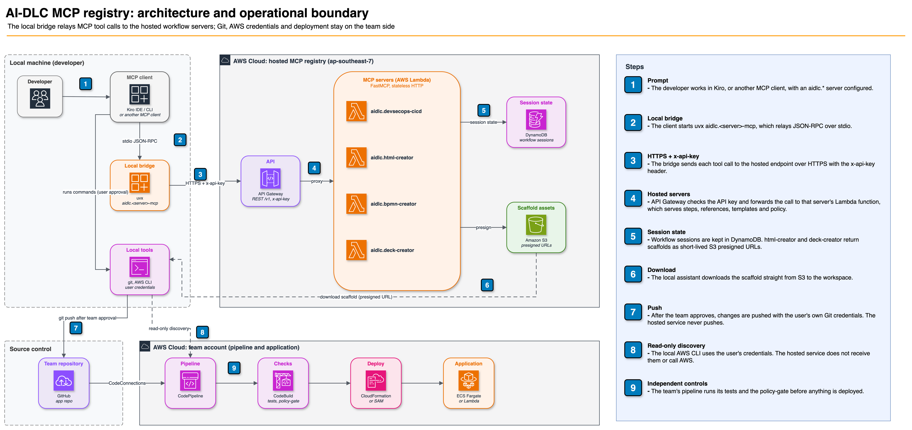

# MSC Labs Agent Registry

_Read this in [ไทย](README.th.md)._

[](https://opensource.org/licenses/Apache-2.0)
[](https://www.python.org/downloads/)

This public repository is the central distribution point for AI-assisted delivery controls maintained
by the AI-DLC Center of Excellence (CoE). It contains reusable Kiro steering and client documentation
for four hosted Model Context Protocol (MCP) workflows. It does not contain the hosted service code
or enforce deployment policy by itself.

> [!IMPORTANT]
> Generative AI can make mistakes. Review generated output, infrastructure changes, security impact,
> and cost before acting. Repository permissions, approvals, and CI/CD pipeline controls remain the
> authoritative enforcement layer.

## Start here

| Goal | Go to | What you will find |
| --- | --- | --- |
| Apply shared standards to a project | [Steering guide](aidlc.kiro/steering/README.md) | Available controls, inclusion modes, and safe copy instructions |
| Evaluate or choose a hosted workflow | [MCP overview](aidlc.kiro/mcp/README.md) | Server catalogue, prerequisites, tool pattern, and boundaries |
| Install, verify, rotate a key, or troubleshoot | [MCP client runbook](aidlc.kiro/mcp/RUNBOOK.md) | Platform-specific operational procedures |
| Understand one workflow | [DevSecOps](aidlc.kiro/mcp/devsecops-cicd/README.md) · [HTML](aidlc.kiro/mcp/html-creator/README.md) · [BPMN](aidlc.kiro/mcp/bpmn-creator/README.md) · [Deck](aidlc.kiro/mcp/deck-creator/README.md) | Workflow-specific tools, steps, and limitations |
| Propose a registry change | [Contributing](#contributing) | Scope, review, and public-repository rules |

## What is available

| Area | Contents |
| --- | --- |
| [`aidlc.kiro/steering/`](aidlc.kiro/steering/README.md) | Guardrails, engineering conventions, and 129 security requirements across four packs |
| [`aidlc.kiro/mcp/`](aidlc.kiro/mcp/README.md) | Configuration and documentation for four hosted workflow servers |
| [`docs/diagrams/`](docs/diagrams/) | Editable draw.io sources and rendered architecture diagrams |

The [`skills`](aidlc.kiro/skills/README.md) and [`hooks`](aidlc.kiro/hooks/README.md) folders currently
document contributor formats only; no distributable entries are available yet.

## How governance works

The registry supports three separate control layers:

1. **Steering guides the assistant.** Teams copy relevant files into a workspace. These files are
   locally editable, so steering influences output but cannot guarantee or enforce a result.
2. **Hosted MCP workflows standardize a process.** The CoE controls the hosted workflow, reference,
   and policy content. Human gates record decisions, but the service does not deploy on a user's behalf.
3. **Repository and pipeline controls enforce delivery policy.** Permissions, required reviews,
   policy gates, and deployment approvals determine what can merge or ship.

| Role | Access | Responsibility |
| --- | --- | --- |
| **AI-DLC CoE** — engineering, security, and architecture owners | Write through reviewed changes | Maintain shared standards and hosted workflow services |
| **Delivery teams** | Consume the registry and propose changes | Select applicable controls, run workflows, review output, and report gaps |

## Apply steering

Copy only the controls assessed as relevant to the workload. For example, from a project directory:

```bash
git clone --depth 1 https://github.com/AIDLC-KIRO/msclabs.agent-registry.git /tmp/registry
mkdir -p .kiro/steering/security-requirements/pci-dss
cp -R /tmp/registry/aidlc.kiro/steering/guardrails .kiro/steering/

# Example: copy one PCI DSS requirement selected during assessment.
PCI_REQUIREMENT=network-security-controls-for-traffic-segmentation.md
cp "/tmp/registry/aidlc.kiro/steering/security-requirements/pci-dss/$PCI_REQUIREMENT" \
   .kiro/steering/security-requirements/pci-dss/
```

Review files before copying them, then commit the selected controls so the project records the
version it uses. Copy a whole pack only when the scope assessment says the complete pack applies.
Do not copy every pack by default: each requirement file currently matches all files in context and
can add substantial standing context. See the [steering guide](aidlc.kiro/steering/README.md) for
selection guidance and inclusion modes.

### Security requirement packs

| Pack | Requirements | Coverage |
| --- | --- | --- |
| [ASA base pack](aidlc.kiro/steering/security-requirements/asa-base-pack/_index.md) | 10 | Authentication, authorization, audit logging, secret protection, tenant isolation, trusted cryptography |
| [AWS Well-Architected](aidlc.kiro/steering/security-requirements/aws-well-architected/_index.md) | 32 | Encryption, network segmentation, least privilege, credential management, threat modeling |
| [NIST CSF](aidlc.kiro/steering/security-requirements/nist-csf/_index.md) | 37 | Identify, protect, detect, respond, recover |
| [PCI DSS](aidlc.kiro/steering/security-requirements/pci-dss/_index.md) | 50 | Cardholder-data scope, segmentation, logging, key management, secure development |

ISO 27001 and Thailand's Personal Data Protection Act (PDPA) packs are not included. Existing
requirements may overlap with those frameworks, but this repository does not claim coverage without
a dedicated mapping.

## Connect hosted MCP workflows

| Server | Purpose | Tools | Documentation |
| --- | --- | --- | --- |
| `aidlc.devsecops-cicd` | Prepare applications, review policy, observe pipelines, and hand off deployment | 14 | [Guide](aidlc.kiro/mcp/devsecops-cicd/README.md) |
| `aidlc.html-creator` | Build offline bilingual documentation from AWS Transform assessments | 14 | [Guide](aidlc.kiro/mcp/html-creator/README.md) |
| `aidlc.bpmn-creator` | Model BPMN 2.0 swimlanes and support departmental review | 12 | [Guide](aidlc.kiro/mcp/bpmn-creator/README.md) |
| `aidlc.deck-creator` | Build HTML presentations, executive summaries, and progress reports | 16 | [Guide](aidlc.kiro/mcp/deck-creator/README.md) |

Each PyPI package is a local standard input/output (stdio) bridge to a hosted service. Workflow
steps, references, templates, and policy content remain hosted.

### Prerequisites

- Kiro IDE, the documented and tested client
- [uv](https://docs.astral.sh/uv/getting-started/installation/) and Python 3.10 or later
- An access key from the deploying organization or service owner
- Outbound HTTPS to `*.execute-api.ap-southeast-7.amazonaws.com`
- For BPMN only: Node.js and the [draw.io MCP server](https://www.npmjs.com/package/@drawio/mcp)

Follow the [MCP client runbook](aidlc.kiro/mcp/RUNBOOK.md) for installation and verification. The
repository sample [`mcp.json`](aidlc.kiro/mcp/mcp.json) enables all four AIDLC servers; remove entries
you are not approved to use or do not need. A service owner may instead provide a reduced configuration.
BPMN also requires the separate draw.io entry shown in its [installation guide](aidlc.kiro/mcp/bpmn-creator/README.md#installation).

Describe the intended result in chat, for example:

```text
Prepare repo my-org/my-service for the development pipeline
Build a documentation site from ./ATXDocumentation
Map the leave-request process as BPMN
Build an executive summary from .kiro/specs/order-service
```

## Getting access

Reading this repository requires no credential. Hosted services require an access key supplied by
the deploying organization or service owner. No public key-request or guaranteed support route is
documented here. The service owner must provide issuance, expiry, rotation, revocation, and incident
contacts. Never share a key or commit it to source control. See the runbook section on
[key rotation and revocation](aidlc.kiro/mcp/RUNBOOK.md#7-rotate-or-revoke-a-key).

## Architecture and operational boundary



Diagram sources are in [`docs/diagrams/`](docs/diagrams/). The PNG files embed draw.io data and can
be opened directly in draw.io.

- The local client may run approved commands with credentials available on the user's machine.
- The hosted service does not receive local AWS credentials, run AWS commands on the user's behalf,
  push source code, or deploy applications.
- Tool arguments are sent to the hosted service over HTTPS. A validation tool evaluates only the
  data supplied in its arguments; it does not inspect the local filesystem remotely.
- File changes, builds, Git operations, and deployments remain under local approval and independent
  repository and pipeline controls.

## Data handling and privacy

Do not send secrets, credentials, or regulated or sensitive data unless the organization has
approved the service for that use. This repository does not document retention, service-side
logging, or data-residency guarantees. Obtain those details from the service owner before submitting
data with specific handling requirements.

## Environment variables

| Variable | Description | Default |
| --- | --- | --- |
| `MCP_API_TOKEN` | Access key; required | — |
| `MSCLABS_MCP_TOKEN` | Alternative access-key variable | — |
| `MSCLABS_MCP_BASE_URL` | Alternative service deployment | CoE endpoint |
| `MSCLABS_MCP_TIMEOUT` | Request timeout in seconds | `120` |

## Getting help

Use the organization-specific support and incident routes supplied by the service owner. If public
issues are enabled, never include credentials, sensitive tool arguments, internal identifiers, or
unredacted logs.

## Contributing

Open a reviewed change against `main` through the route established by your organization. New
compliance packs belong under `aidlc.kiro/steering/security-requirements/<pack>/` and must describe
both coverage and limitations. Do not add secrets, credentials, account identifiers, Amazon
Resource Names (ARNs), private network identifiers, or internal endpoints to this public repository.

## License

Apache-2.0. See [LICENSE](LICENSE).
