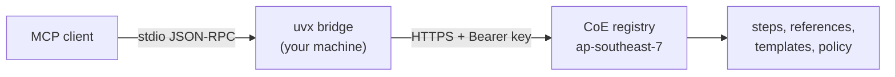

# MSC Labs Agent Registry

_Read this in other languages: [ไทย](README.th.md)_

[](https://opensource.org/licenses/Apache-2.0)
[](https://www.python.org/downloads/)
[](https://pypi.org/project/msclabs.devsecops-cicd-mcp-server/)

Hosted Model Context Protocol (MCP) workflows that turn an AI coding assistant into a
guarded delivery process: deploying through a DevSecOps pipeline, turning a migration
assessment into a documentation site, and mapping a business process to BPMN.

Each workflow runs as a remote MCP server in the MSC Labs CoE account. What you install is a
small stdio bridge from PyPI; the steps, reference documents, templates and policy packs stay
server-side, so every team runs the version the CoE published and nobody can quietly edit a
guardrail on a laptop.

> [!IMPORTANT]
> Generative AI can make mistakes. Review all output, infrastructure changes and costs before
> acting on them. These workflows stop at approval gates for exactly that reason — the gates
> are not a formality.

## What's in here

This repository holds documentation and example configuration. No server source code.

```
aidlc.kiro/
  mcp/        hosted MCP servers: install, tools, runbook
  skills/     agent skills
  steering/   steering files
  hooks/      agent hooks
```

| Folder | Contents | Status |
| --- | --- | --- |
| [`aidlc.kiro/mcp/`](aidlc.kiro/mcp/) | Three hosted workflow servers, published clients, operations runbook | Available |
| [`aidlc.kiro/skills/`](aidlc.kiro/skills/) | Agent skills distributed by the CoE | No entries yet |
| [`aidlc.kiro/steering/`](aidlc.kiro/steering/) | Guardrails, conventions, and 129 security requirements in four packs | Available |
| [`aidlc.kiro/hooks/`](aidlc.kiro/hooks/) | Agent hooks for `.kiro/hooks/` | No entries yet |

## MCP servers

| Server | What it does | Tools | Docs |
| --- | --- | --- | --- |
| **msclabs.devsecops-cicd** | Take an application through a DevSecOps pipeline — buildspecs, IaC, portability fixes, push, then drive the pipeline green | 14 | [devsecops-cicd](aidlc.kiro/mcp/devsecops-cicd/README.md) |
| **msclabs.html-creator** | Turn AWS Transform assessment reports (CCA, BRE, MRA) into a bilingual documentation site that opens offline | 14 | [html-creator](aidlc.kiro/mcp/html-creator/README.md) |
| **msclabs.bpmn-creator** | Map a business process to a BPMN 2.0 swimlane `.drawio` file, then refine it with per-department review | 12 | [bpmn-creator](aidlc.kiro/mcp/bpmn-creator/README.md) |

## Prerequisites

1. An MCP-compatible client. Kiro IDE is the reference client; anything that speaks stdio MCP works.
2. [uv](https://docs.astral.sh/uv/getting-started/installation/) installed, for `uvx`.
3. Python 3.10+ (`uv python install 3.10`).
4. An API key issued by the MSC Labs CoE — see [Getting access](#getting-access).
5. Outbound HTTPS to `rh7x5fl9j3.execute-api.ap-southeast-7.amazonaws.com`.

The `bpmn-creator` workflow also needs the [draw.io MCP server](https://www.npmjs.com/package/@drawio/mcp)
and Node.js, because it does not draw by itself.

## Getting access

The servers authenticate with an API key, one per consumer — per person, or per automated job.
A key owns the sessions it opens, so a shared key means shared sessions.

Ask the MSC Labs CoE for a key. You will receive a string shaped like
`aidlcmcp_<12 chars>_<long random part>`. It is shown once at creation and only its SHA-256
digest is stored, so a lost key cannot be recovered — it has to be revoked and reissued. Report
a leaked key immediately; revocation takes effect on the next call and affects only that key.

## Installation

Set your key in the environment first:

```bash
# macOS, Linux, WSL
mkdir -p ~/.aidlc
printf '%s' 'PASTE_YOUR_KEY' > ~/.aidlc/mcp-token
chmod 600 ~/.aidlc/mcp-token
echo 'export MCP_API_TOKEN=$(cat ~/.aidlc/mcp-token)' >> ~/.zshrc
```

```powershell
# Windows
setx MCP_API_TOKEN "PASTE_YOUR_KEY"
```

Then add the servers to your client's MCP configuration — in Kiro, `~/.kiro/settings/mcp.json`
for every project or `.kiro/settings/mcp.json` for one. The same file is in
[`aidlc.kiro/mcp/mcp.json`](aidlc.kiro/mcp/mcp.json).

```json
{
  "mcpServers": {
    "msclabs.devsecops-cicd": {
      "command": "uvx",
      "args": ["msclabs.devsecops-cicd-mcp-server==1.1.0"],
      "env": { "MCP_API_TOKEN": "${MCP_API_TOKEN}" }
    },
    "msclabs.html-creator": {
      "command": "uvx",
      "args": ["msclabs.html-creator-mcp-server==1.1.0"],
      "env": { "MCP_API_TOKEN": "${MCP_API_TOKEN}" }
    },
    "msclabs.bpmn-creator": {
      "command": "uvx",
      "args": ["msclabs.bpmn-creator-mcp-server==1.1.0"],
      "env": { "MCP_API_TOKEN": "${MCP_API_TOKEN}" }
    }
  }
}
```

In Kiro, also allow the variable name through — add `MCP_API_TOKEN` to
`kiroAgent.mcpApprovedEnvVars` in user settings — then quit and reopen the application, not just
the window. Skipping either step produces a misleading OAuth error; see
[Troubleshooting](#troubleshooting).

Versions are pinned on purpose. `@latest` means every machine silently takes a new bridge
whenever one is published, which is the thing a registry exists to prevent.

Full install, verification, upgrade and key-rotation procedures are in the
[runbook](aidlc.kiro/mcp/RUNBOOK.md).

## Usage

You do not call tools by hand. Describe the work in chat and the assistant calls the workflow in
order, stopping where the server tells it to stop.

```text
Deploy repo my-org/my-service to the dev pipeline
Build a documentation site from the ATX reports in ./ATXDocumentation
Map the leave request process as BPMN
```

All three servers expose the same session shape. `<prefix>` is `cicd`, `html` or `bpmn`.

| Tool | Purpose |
| --- | --- |
| `<prefix>_start` | Open a session |
| `<prefix>_step_get` | Get the current step's instructions and references |
| `<prefix>_step_submit` | Record findings and advance; rejected if required findings are missing |
| `<prefix>_step_skip` | Skip a step the workflow marks optional |
| `<prefix>_gate_confirm` | Record a human's answer at a gate and unlock the steps behind it (`cicd`, `html`) |
| `<prefix>_session_status` | Where the session stands, for resuming after a break |
| `<prefix>_run_log` | Log one iterate-and-verify round; the same cause three times stops the session |
| `<prefix>_request_draft` | Draft the request to send when something is outside your control |
| `<prefix>_catalogue_list`, `_reference_get`, `_asset_get` | Pull reference documents and templates from the server |

Per-server tools and step-by-step flows are in each server's README.

## How it works



The bridge reads one JSON-RPC message per line from stdin, posts it upstream with your API key,
and writes the reply to stdout. Diagnostics go to stderr. It depends on the Python standard
library alone — no third-party package ever sees your key, and `uvx` start-up is the download of
one small wheel.

## Environment variables

| Variable | Description | Default |
| --- | --- | --- |
| `MCP_API_TOKEN` | Your API key. Required. | — |
| `MSCLABS_MCP_TOKEN` | Alternative name for the key | — |
| `MSCLABS_MCP_BASE_URL` | Point at a different deployment | the CoE endpoint |
| `MSCLABS_MCP_TIMEOUT` | Seconds to wait for one call | `120` |

## Best practices

- Review generated buildspecs, IaC and pipeline changes before pushing. The workflow prepares a
  change set; your team owns the merge.
- Never pass a secret value to any tool. Pass the *name* — an SSM parameter path, a Secrets
  Manager entry — never the contents.
- Keep one key per person and per automated job. Revoke instead of resharing.
- Treat a gate as a decision point with a named owner, not a prompt to click through.
- When a session stops after three identical failures, find the cause rather than restarting.

## Troubleshooting

| Symptom | Fix |
| --- | --- |
| `Dynamic Client Registration rejected (HTTP 404)` | Not OAuth. The key never reached the server. Check it is in your client's approved environment variables, that the variable has a value in a fresh terminal, and that you fully restarted the client. |
| `No API key` in the server log | The bridge found neither `MCP_API_TOKEN` nor `MSCLABS_MCP_TOKEN`. Set it and restart the client. |
| `401`/`403 … the API key was rejected` | Key truncated, mistyped, expired, revoked, or not scoped to that server. Ask the CoE to check it. |
| `could not reach the registry` | Network cannot reach the endpoint. Check proxy, VPN and firewall, then `curl` the health URL below. |
| `uvx: command not found`, or the server never starts | Your client cannot see `uvx` on `PATH`. Use the absolute path in `command`, or add `PATH` to that server's `env`. |
| Calls time out | Raise `MSCLABS_MCP_TIMEOUT` for that server, for example `"300"`. |
| Connected, but a BPMN diagram never appears | `bpmn-creator` does not draw. Install the draw.io MCP server. |

Health check, no key needed:

```bash
curl -s https://rh7x5fl9j3.execute-api.ap-southeast-7.amazonaws.com/devsecops-cicd/health
```

Key check — `200` means the key works, `401` means it is wrong or revoked:

```bash
curl -s -o /dev/null -w "%{http_code}\n" \
  -X POST https://rh7x5fl9j3.execute-api.ap-southeast-7.amazonaws.com/devsecops-cicd/mcp \
  -H "Authorization: Bearer $MCP_API_TOKEN" \
  -H "Content-Type: application/json" \
  -H "Accept: application/json, text/event-stream" \
  -d '{"jsonrpc":"2.0","id":1,"method":"tools/list","params":{}}'
```

The full diagnostic procedure is in the [runbook](aidlc.kiro/mcp/RUNBOOK.md#8-troubleshooting).

## Security

- The server side never calls AWS on your behalf and cannot deploy anything. Deployment happens
  only through `git push` from your own repository, after your team agrees.
- Keys are stored as SHA-256 digests. Revocation applies on the next call, with no redeploy, and
  affects only the key revoked.
- The bridge sends your key to the registry endpoint and nowhere else.
- Do not report a suspected key leak through a public issue. Contact the CoE directly.

## Getting help

Open an issue with the server name, the client version, the `[msclabs.<server>]` lines from your
MCP log, and the output of the health check. **Never attach an API key.**

## Contributing

Each folder's README states the structure it expects. Open a pull request against `main`.

Workflows that need to enforce policy or hold a gate belong in `aidlc.kiro/mcp/` as a hosted
server, not in `skills/` — a skill on a laptop can be edited, a hosted guardrail cannot. Nothing
in this repository may contain a secret, an API key, an account ID or an internal endpoint.

## License

Apache-2.0. See [LICENSE](LICENSE).
