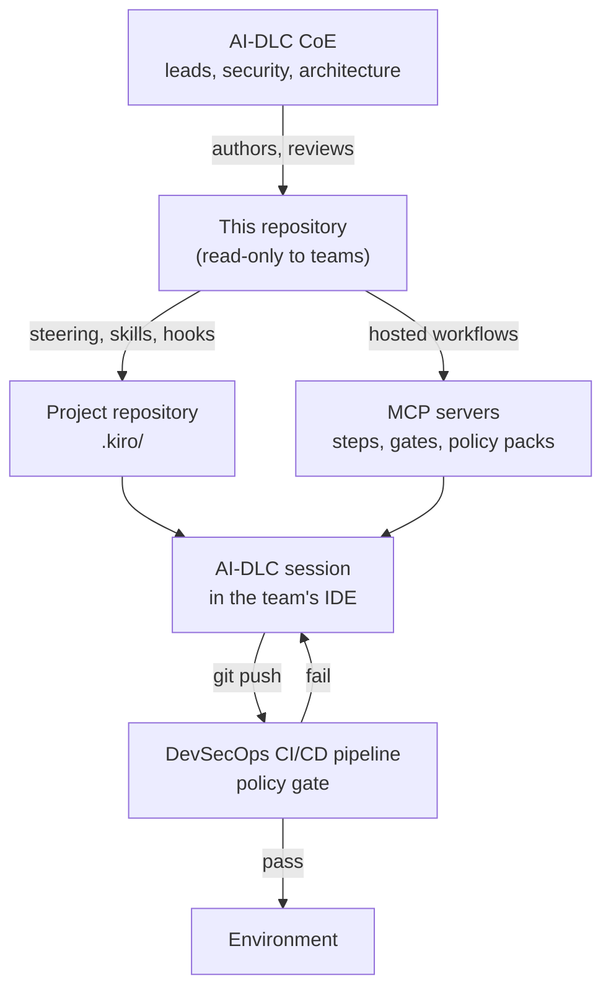
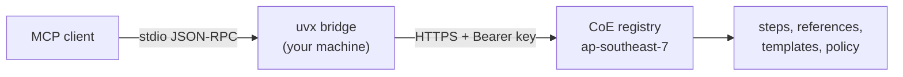

# MSC Labs Agent Registry

_Read this in other languages: [ไทย](README.th.md)_

[](https://opensource.org/licenses/Apache-2.0)
[](https://www.python.org/downloads/)
[](https://pypi.org/project/msclabs.devsecops-cicd-mcp-server/)

The organisation's central configuration store for AI-assisted delivery. The AI-DLC Center of
Excellence maintains one set of guardrails, security requirements, architecture standards and
hosted workflows here; every delivery team inherits the same core framework instead of each
project deciding its own.

A team assigned a project does not negotiate what "secure enough" or "well architected" means.
They pull the organisation's steering files into their repository, and when they run the AI-DLC
process their assistant is working inside those constraints. The same constraints are enforced
again by the DevSecOps CI/CD pipeline before anything reaches an environment.

> [!IMPORTANT]
> Generative AI can make mistakes. Review all output, infrastructure changes and costs before
> acting on them. Steering shapes what an assistant produces; it does not guarantee the result.
> The pipeline gate, not the model, is what decides whether a change ships.

## Who uses this, and how

| Role | Access | What they do here |
| --- | --- | --- |
| **AI-DLC Center of Excellence** — team leads, engineering managers, security and architecture owners | Write, through pull request | Define the guardrails, compliance requirements, architecture standards and conventions the organisation holds every project to. Own the hosted workflow servers. |
| **Delivery teams** | **Read only** | Pull the central configuration into their project repository, run the AI-DLC process under it, and raise a pull request here when a standard needs to change. |

Read-only is deliberate. A guardrail a team can edit locally to make a failing step pass is not
a guardrail. Changes to organisational standards go through the CoE's review, so they apply to
every project at once and the reason for each one stays on the record.

## How governance flows



Three layers of control, doing different jobs:

| Layer | Where it runs | What it does | Can a team bypass it? |
| --- | --- | --- | --- |
| **Steering files** | The team's workspace | Put the organisation's standards in front of the assistant while code is being written | Yes — they are files on a laptop. This is why they guide rather than enforce |
| **Hosted MCP workflows** | The CoE's AWS account | Hold the steps, the approval gates and the policy packs; `cicd_changeset_validate` checks files before they are pushed | No — the workflow is not on their machine |
| **Pipeline policy gate** | The DevSecOps pipeline | The decision point. Blocks a change that violates organisational policy | No |

Steering raises the quality of the first draft. The hosted workflow and the pipeline decide what
is acceptable. Teams get both, and the earlier layers exist so the last one stops being a
surprise.

## What's in here

```
aidlc.kiro/
  steering/   organisational guardrails, compliance requirements, conventions
  mcp/        hosted workflow servers and their published clients
  skills/     agent skills distributed by the CoE
  hooks/      agent hooks for local automation and checks
```

| Folder | Contents | Status |
| --- | --- | --- |
| [`aidlc.kiro/steering/`](aidlc.kiro/steering/) | Guardrails, conventions, and 129 security requirements across four compliance packs | Available |
| [`aidlc.kiro/mcp/`](aidlc.kiro/mcp/) | Three hosted workflow servers, published clients, operations runbook | Available |
| [`aidlc.kiro/skills/`](aidlc.kiro/skills/) | Agent skills distributed by the CoE | No entries yet |
| [`aidlc.kiro/hooks/`](aidlc.kiro/hooks/) | Agent hooks for `.kiro/hooks/` | No entries yet |

### Compliance and standards coverage

| Pack | Requirements | Covers |
| --- | --- | --- |
| [ASA base pack](aidlc.kiro/steering/security-requirements/asa-base-pack/) | 10 | Authentication, authorization, audit logging, secret protection, tenant isolation, trusted cryptography |
| [AWS Well-Architected](aidlc.kiro/steering/security-requirements/aws-well-architected/) | 32 | Encryption, network segmentation, least privilege, key and credential management, threat modelling |
| [NIST CSF](aidlc.kiro/steering/security-requirements/nist-csf/) | 37 | Identify, protect, detect, respond, recover |
| [PCI DSS](aidlc.kiro/steering/security-requirements/pci-dss/) | 50 | Cardholder data scope, CDE segmentation, logging, key management, secure development |

ISO 27001 and PDPA packs are **not here yet**. Several requirements in the existing packs map
onto both — audit logging, data classification, secret protection, data lifecycle — but no pack
is organised against those frameworks or claims coverage of them. Adding one follows
[Contributing](#contributing).

Architecture and engineering standards live alongside the compliance packs:
[`best-practices/`](aidlc.kiro/steering/best-practices/) (Twelve-Factor, Terraform,
Well-Architected context), [`development-practices/`](aidlc.kiro/steering/development-practices/),
[`project-standards/`](aidlc.kiro/steering/project-standards/), and
[`guardrails/`](aidlc.kiro/steering/guardrails/), which holds the non-negotiables — source code is
the source of truth, and nothing gets invented to fill a gap.

## For delivery teams

### 1. Pull the central configuration into your project

Clone read-only and copy in what applies to your workload. Take the packs your project is
actually assessed against, not all four.

```bash
git clone --depth 1 https://github.com/AIDLC-KIRO/msclabs.agent-registry.git /tmp/registry

mkdir -p .kiro/steering
cp -R /tmp/registry/aidlc.kiro/steering/guardrails           .kiro/steering/
cp -R /tmp/registry/aidlc.kiro/steering/development-practices .kiro/steering/
cp -R /tmp/registry/aidlc.kiro/steering/security-requirements/pci-dss \
      .kiro/steering/security-requirements/
```

Commit what you copied, so the standards your project was built against are recorded with it.
Re-run the copy to take an update; the [steering README](aidlc.kiro/steering/README.md) explains
inclusion modes and the cost of pulling in a whole pack.

To track the registry as a dependency rather than copying, add it as a submodule
(`git submodule add`) and point `.kiro/steering` at the relevant paths. Either pattern works —
pick one and keep it consistent across the team's repositories.

### 2. Connect the hosted workflows

See [Installation](#installation) below. The workflows hold the approval gates and the policy
packs, and they are how the AI-DLC process stays the same across teams.

### 3. Run the process

Describe the work in chat. The assistant calls the workflow in order, stops at the gates, and
validates files against the CoE's policy packs before you push.

### 4. Ask for a change instead of working around one

If a standard blocks legitimate work, open a pull request or an issue here. That is the intended
path, and it is faster than it sounds — a standard that blocks one team usually needs fixing for
everyone.

## For the CoE

Author standards as steering files, review them as pull requests, and merge to `main`. Teams
pick up the change on their next sync.

Keep organisation-specific values out of this repository — it is public. Account IDs, ARNs, VPC
and subnet IDs and internal URLs belong in private repositories or in SSM; steering here states
the requirement, not the environment.

Workflows that must enforce policy or hold a gate belong in [`aidlc.kiro/mcp/`](aidlc.kiro/mcp/)
as a hosted server, not in `skills/` or `steering/`. Hosting it is what makes it binding. The
operational side — deploying, issuing and revoking keys, verifying a deployment — is in the
[runbook](aidlc.kiro/mcp/RUNBOOK.md).

## MCP servers

| Server | What it does | Tools | Docs |
| --- | --- | --- | --- |
| **msclabs.devsecops-cicd** | Take an application through the DevSecOps pipeline — buildspecs, IaC, portability fixes, push, then drive the pipeline green | 14 | [devsecops-cicd](aidlc.kiro/mcp/devsecops-cicd/README.md) |
| **msclabs.html-creator** | Turn AWS Transform assessment reports (CCA, BRE, MRA) into a bilingual documentation site that opens offline | 14 | [html-creator](aidlc.kiro/mcp/html-creator/README.md) |
| **msclabs.bpmn-creator** | Map a business process to a BPMN 2.0 swimlane `.drawio` file, then refine it with per-department review | 12 | [bpmn-creator](aidlc.kiro/mcp/bpmn-creator/README.md) |

Each runs as a remote MCP server in the CoE account. What you install is a small stdio bridge
from PyPI; the steps, reference documents, templates and policy packs stay server-side, so every
team runs the version the CoE published.

## Prerequisites

1. An MCP-compatible client. Kiro IDE is the reference client; anything that speaks stdio MCP works.
2. [uv](https://docs.astral.sh/uv/getting-started/installation/) installed, for `uvx`.
3. Python 3.10+ (`uv python install 3.10`).
4. An API key issued by the CoE — see [Getting access](#getting-access).
5. Outbound HTTPS to `rh7x5fl9j3.execute-api.ap-southeast-7.amazonaws.com`.

The `bpmn-creator` workflow also needs the [draw.io MCP server](https://www.npmjs.com/package/@drawio/mcp)
and Node.js, because it does not draw by itself.

## Getting access

Reading this repository needs nothing. The hosted workflows authenticate with an API key, one per
consumer — per person, or per automated job. A key owns the sessions it opens, so a shared key
means shared sessions.

Ask the CoE for a key. You will receive a string shaped like
`aidlcmcp_<12 chars>_<long random part>`. It is shown once at creation and only its SHA-256
digest is stored, so a lost key cannot be recovered — it has to be revoked and reissued. Report a
leaked key immediately; revocation takes effect on the next call and affects only that key.

## Installation

Set your key in the environment first:

```bash
# macOS, Linux, WSL
mkdir -p ~/.aidlc
printf '%s' 'PASTE_YOUR_KEY' > ~/.aidlc/mcp-token
chmod 600 ~/.aidlc/mcp-token
echo 'export MCP_API_TOKEN=$(cat ~/.aidlc/mcp-token)' >> ~/.zshrc
```

```powershell
# Windows
setx MCP_API_TOKEN "PASTE_YOUR_KEY"
```

Then add the servers to your client's MCP configuration — in Kiro, `~/.kiro/settings/mcp.json`
for every project or `.kiro/settings/mcp.json` for one. The same file is in
[`aidlc.kiro/mcp/mcp.json`](aidlc.kiro/mcp/mcp.json).

```json
{
  "mcpServers": {
    "msclabs.devsecops-cicd": {
      "command": "uvx",
      "args": ["msclabs.devsecops-cicd-mcp-server==1.1.0"],
      "env": { "MCP_API_TOKEN": "${MCP_API_TOKEN}" }
    },
    "msclabs.html-creator": {
      "command": "uvx",
      "args": ["msclabs.html-creator-mcp-server==1.1.0"],
      "env": { "MCP_API_TOKEN": "${MCP_API_TOKEN}" }
    },
    "msclabs.bpmn-creator": {
      "command": "uvx",
      "args": ["msclabs.bpmn-creator-mcp-server==1.1.0"],
      "env": { "MCP_API_TOKEN": "${MCP_API_TOKEN}" }
    }
  }
}
```

In Kiro, also allow the variable name through — add `MCP_API_TOKEN` to
`kiroAgent.mcpApprovedEnvVars` in user settings — then quit and reopen the application, not just
the window. Skipping either step produces a misleading OAuth error; see
[Troubleshooting](#troubleshooting).

Versions are pinned on purpose. `@latest` means every machine silently takes a new bridge
whenever one is published, which is the thing a central registry exists to prevent.

Full install, verification, upgrade and key-rotation procedures are in the
[runbook](aidlc.kiro/mcp/RUNBOOK.md).

## Usage

You do not call tools by hand. Describe the work in chat and the assistant calls the workflow in
order, stopping where the server tells it to stop.

```text
Deploy repo my-org/my-service to the dev pipeline
Build a documentation site from the ATX reports in ./ATXDocumentation
Map the leave request process as BPMN
```

All three servers expose the same session shape. `<prefix>` is `cicd`, `html` or `bpmn`.

| Tool | Purpose |
| --- | --- |
| `<prefix>_start` | Open a session |
| `<prefix>_step_get` | Get the current step's instructions and references |
| `<prefix>_step_submit` | Record findings and advance; rejected if required findings are missing |
| `<prefix>_step_skip` | Skip a step the workflow marks optional |
| `<prefix>_gate_confirm` | Record a human's answer at a gate and unlock the steps behind it (`cicd`, `html`) |
| `<prefix>_session_status` | Where the session stands, for resuming after a break |
| `<prefix>_run_log` | Log one iterate-and-verify round; the same cause three times stops the session |
| `<prefix>_request_draft` | Draft the request to send when something is outside your control |
| `<prefix>_catalogue_list`, `_reference_get`, `_asset_get` | Pull reference documents and templates from the server |

Per-server tools and step-by-step flows are in each server's README.

## How the hosted workflows work



The bridge reads one JSON-RPC message per line from stdin, posts it upstream with your API key,
and writes the reply to stdout. Diagnostics go to stderr. It depends on the Python standard
library alone — no third-party package ever sees your key, and `uvx` start-up is the download of
one small wheel.

## Environment variables

| Variable | Description | Default |
| --- | --- | --- |
| `MCP_API_TOKEN` | Your API key. Required. | — |
| `MSCLABS_MCP_TOKEN` | Alternative name for the key | — |
| `MSCLABS_MCP_BASE_URL` | Point at a different deployment | the CoE endpoint |
| `MSCLABS_MCP_TIMEOUT` | Seconds to wait for one call | `120` |

## Best practices

- Review generated buildspecs, IaC and pipeline changes before pushing. The workflow prepares a
  change set; your team owns the merge.
- Take the compliance packs your workload is assessed against, not all of them. Everything you
  install is standing context on every request.
- Never pass a secret value to any tool. Pass the *name* — an SSM parameter path, a Secrets
  Manager entry — never the contents.
- Keep one key per person and per automated job. Revoke instead of resharing.
- Treat a gate as a decision point with a named owner, not a prompt to click through.
- When a session stops after three identical failures, find the cause rather than restarting.
- Change a standard here rather than working around it in one project. A local workaround hides
  the problem from every other team.

## Troubleshooting

| Symptom | Fix |
| --- | --- |
| `Dynamic Client Registration rejected (HTTP 404)` | Not OAuth. The key never reached the server. Check it is in your client's approved environment variables, that the variable has a value in a fresh terminal, and that you fully restarted the client. |
| `No API key` in the server log | The bridge found neither `MCP_API_TOKEN` nor `MSCLABS_MCP_TOKEN`. Set it and restart the client. |
| `401`/`403 … the API key was rejected` | Key truncated, mistyped, expired, revoked, or not scoped to that server. Ask the CoE to check it. |
| `could not reach the registry` | Network cannot reach the endpoint. Check proxy, VPN and firewall, then `curl` the health URL below. |
| `uvx: command not found`, or the server never starts | Your client cannot see `uvx` on `PATH`. Use the absolute path in `command`, or add `PATH` to that server's `env`. |
| Calls time out | Raise `MSCLABS_MCP_TIMEOUT` for that server, for example `"300"`. |
| Connected, but a BPMN diagram never appears | `bpmn-creator` does not draw. Install the draw.io MCP server. |
| Steering files seem to be ignored | Start a new session; a running one does not pick up newly copied steering. Then check the `inclusion` frontmatter matches what you expect. |

Health check, no key needed:

```bash
curl -s https://rh7x5fl9j3.execute-api.ap-southeast-7.amazonaws.com/devsecops-cicd/health
```

Key check — `200` means the key works, `401` means it is wrong or revoked:

```bash
curl -s -o /dev/null -w "%{http_code}\n" \
  -X POST https://rh7x5fl9j3.execute-api.ap-southeast-7.amazonaws.com/devsecops-cicd/mcp \
  -H "Authorization: Bearer $MCP_API_TOKEN" \
  -H "Content-Type: application/json" \
  -H "Accept: application/json, text/event-stream" \
  -d '{"jsonrpc":"2.0","id":1,"method":"tools/list","params":{}}'
```

The full diagnostic procedure is in the [runbook](aidlc.kiro/mcp/RUNBOOK.md#8-troubleshooting).

## Security

- This repository is public and holds no secret, key, account ID or internal endpoint. Steering
  states requirements, never environment values.
- The server side never calls AWS on your behalf and cannot deploy anything. Deployment happens
  only through `git push` from your own repository, after your team agrees.
- Keys are stored as SHA-256 digests. Revocation applies on the next call, with no redeploy, and
  affects only the key revoked.
- The bridge sends your key to the registry endpoint and nowhere else.
- Do not report a suspected key leak through a public issue. Contact the CoE directly.

## Getting help

Open an issue with the server name, the client version, the `[msclabs.<server>]` lines from your
MCP log, and the output of the health check. **Never attach an API key.**

## Contributing

Delivery teams have read access and contribute by pull request; the CoE reviews and merges. Each
folder's README states the structure it expects.

A new compliance pack — ISO 27001 or PDPA, for instance — goes in
`aidlc.kiro/steering/security-requirements/<pack>/` with an `_index.md` listing its requirements,
one file per requirement, following the shape of the existing packs. State what the pack covers
and what it does not; a pack that implies coverage it lacks is worse than no pack.

Nothing in this repository may contain a secret, an API key, an account ID, an ARN or an internal
endpoint.

## License

Apache-2.0. See [LICENSE](LICENSE).
