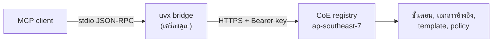

# MSC Labs Agent Registry

_อ่านภาษาอื่น: [English](README.md)_

[](https://opensource.org/licenses/Apache-2.0)
[](https://www.python.org/downloads/)
[](https://pypi.org/project/msclabs.devsecops-cicd-mcp-server/)

workflow แบบ Model Context Protocol (MCP) ที่โฮสต์ไว้ให้ ซึ่งเปลี่ยน AI coding assistant
ให้เป็นกระบวนการส่งมอบงานที่มีการ์ดคุม ทั้งการ deploy ผ่าน pipeline DevSecOps
การเปลี่ยนรายงาน assessment เป็นเว็บเอกสาร และการวาด business process เป็น BPMN

แต่ละ workflow รันเป็น remote MCP server ในบัญชีของ MSC Labs CoE สิ่งที่คุณติดตั้งลงเครื่องคือ
bridge ตัวเล็ก ๆ จาก PyPI ส่วนขั้นตอน เอกสารอ้างอิง template และ policy pack อยู่ฝั่ง server ทั้งหมด
ทุกทีมจึงรันเวอร์ชันเดียวกับที่ CoE publish และไม่มีใครแก้การ์ดเงียบ ๆ บนเครื่องตัวเองได้

> [!IMPORTANT]
> Generative AI ผิดพลาดได้ ตรวจผลลัพธ์ การเปลี่ยน infrastructure และค่าใช้จ่ายทุกครั้งก่อนลงมือ
> workflow เหล่านี้หยุดที่ approval gate ด้วยเหตุผลนี้ gate ไม่ใช่พิธีกรรม

## มีอะไรใน repo นี้

repo นี้เก็บเอกสารและ config ตัวอย่าง ไม่มี source code ของ server

```
aidlc.kiro/
  mcp/        MCP server ที่โฮสต์ไว้: วิธีติดตั้ง, tool, runbook
  skills/     agent skill
  steering/   steering file
  hooks/      agent hook
```

| folder | เก็บอะไร | สถานะ |
| --- | --- | --- |
| [`aidlc.kiro/mcp/`](aidlc.kiro/mcp/) | workflow server สามตัว, client ที่ publish แล้ว, runbook | ใช้งานได้ |
| [`aidlc.kiro/skills/`](aidlc.kiro/skills/) | agent skill ที่ CoE แจกจ่าย | ยังไม่มีรายการ |
| [`aidlc.kiro/steering/`](aidlc.kiro/steering/) | guardrail, convention และ security requirement 129 ข้อใน 4 pack | ใช้งานได้ |
| [`aidlc.kiro/hooks/`](aidlc.kiro/hooks/) | agent hook สำหรับ `.kiro/hooks/` | ยังไม่มีรายการ |

## MCP server

| server | ทำอะไร | tool | เอกสาร |
| --- | --- | --- | --- |
| **msclabs.devsecops-cicd** | เอาแอปขึ้น pipeline DevSecOps ตั้งแต่ buildspec, IaC, portability fix, push แล้วไล่ให้ pipeline เขียว | 14 | [devsecops-cicd](aidlc.kiro/mcp/devsecops-cicd/README.md) |
| **msclabs.html-creator** | เปลี่ยนรายงาน assessment ของ AWS Transform (CCA, BRE, MRA) เป็นเว็บเอกสารสองภาษาที่เปิดแบบ offline ได้ | 14 | [html-creator](aidlc.kiro/mcp/html-creator/README.md) |
| **msclabs.bpmn-creator** | วาด business process เป็น BPMN 2.0 swimlane ไฟล์ `.drawio` แล้วปรับด้วยการทบทวนรายแผนก | 12 | [bpmn-creator](aidlc.kiro/mcp/bpmn-creator/README.md) |

## สิ่งที่ต้องมี

1. MCP client — Kiro IDE เป็นตัวอ้างอิง ตัวอื่นที่พูด stdio MCP ได้ก็ใช้ได้
2. ติดตั้ง [uv](https://docs.astral.sh/uv/getting-started/installation/) เพื่อใช้ `uvx`
3. Python 3.10 ขึ้นไป (`uv python install 3.10`)
4. API key ที่ MSC Labs CoE ออกให้ — ดู [การขอสิทธิ์ใช้งาน](#การขอสิทธิ์ใช้งาน)
5. ออก HTTPS ไปยัง `rh7x5fl9j3.execute-api.ap-southeast-7.amazonaws.com` ได้

workflow `bpmn-creator` ต้องมี [draw.io MCP server](https://www.npmjs.com/package/@drawio/mcp)
และ Node.js เพิ่ม เพราะตัวมันเองไม่ได้วาด

## การขอสิทธิ์ใช้งาน

server ยืนยันตัวตนด้วย API key หนึ่งใบต่อหนึ่งผู้ใช้ จะเป็นต่อคนหรือต่องานอัตโนมัติก็ได้
key เป็นเจ้าของ session ที่มันเปิด การแชร์ key จึงเท่ากับแชร์ session

ขอ key จาก MSC Labs CoE จะได้ข้อความรูปแบบ `aidlcmcp_<12 ตัว>_<ส่วนสุ่มยาว ๆ>`
key แสดงครั้งเดียวตอนสร้าง และเก็บไว้แค่ค่า SHA-256 digest ดังนั้น key ที่หายไปกู้คืนไม่ได้
ต้อง revoke แล้วออกใบใหม่ ถ้า key หลุดให้แจ้งทันที การ revoke มีผลตั้งแต่ call ถัดไป
และกระทบแค่ใบนั้นใบเดียว

## การติดตั้ง

ตั้ง key ลง environment ก่อน

```bash
# macOS, Linux, WSL
mkdir -p ~/.aidlc
printf '%s' 'PASTE_YOUR_KEY' > ~/.aidlc/mcp-token
chmod 600 ~/.aidlc/mcp-token
echo 'export MCP_API_TOKEN=$(cat ~/.aidlc/mcp-token)' >> ~/.zshrc
```

```powershell
# Windows
setx MCP_API_TOKEN "PASTE_YOUR_KEY"
```

แล้วเพิ่ม server ลง MCP config ของ client ถ้าเป็น Kiro คือ `~/.kiro/settings/mcp.json`
สำหรับทุกโปรเจกต์ หรือ `.kiro/settings/mcp.json` สำหรับโปรเจกต์เดียว ไฟล์เดียวกันอยู่ที่
[`aidlc.kiro/mcp/mcp.json`](aidlc.kiro/mcp/mcp.json)

```json
{
  "mcpServers": {
    "msclabs.devsecops-cicd": {
      "command": "uvx",
      "args": ["msclabs.devsecops-cicd-mcp-server==1.1.0"],
      "env": { "MCP_API_TOKEN": "${MCP_API_TOKEN}" }
    },
    "msclabs.html-creator": {
      "command": "uvx",
      "args": ["msclabs.html-creator-mcp-server==1.1.0"],
      "env": { "MCP_API_TOKEN": "${MCP_API_TOKEN}" }
    },
    "msclabs.bpmn-creator": {
      "command": "uvx",
      "args": ["msclabs.bpmn-creator-mcp-server==1.1.0"],
      "env": { "MCP_API_TOKEN": "${MCP_API_TOKEN}" }
    }
  }
}
```

ใน Kiro ต้องอนุญาตชื่อตัวแปรด้วย เพิ่ม `MCP_API_TOKEN` ลงใน `kiroAgent.mcpApprovedEnvVars`
ใน user settings แล้วปิดเปิดแอปให้สุด ไม่ใช่แค่ปิดหน้าต่าง ถ้าข้ามขั้นใดขั้นหนึ่งจะได้ error
เรื่อง OAuth ที่ชี้ผิดทาง ดู [การแก้ปัญหา](#การแก้ปัญหา)

การปักเวอร์ชันเป็นเจตนา `@latest` ทำให้ทุกเครื่องดึง bridge ตัวใหม่เงียบ ๆ ทุกครั้งที่มีการ publish
ซึ่งเป็นสิ่งที่ registry มีไว้เพื่อป้องกัน

ขั้นตอนติดตั้ง ตรวจสอบ อัปเกรด และเปลี่ยน key แบบเต็มอยู่ใน [runbook](aidlc.kiro/mcp/RUNBOOK.md)

## การใช้งาน

คุณไม่ต้องเรียก tool ด้วยมือ พิมพ์ในแชตว่าจะทำอะไร assistant จะเรียก workflow ตามลำดับ
และหยุดตรงที่ server สั่งให้หยุด

```text
deploy repo my-org/my-service ขึ้น pipeline dev ให้ด้วย
ทำเว็บเอกสารจากรายงาน ATX ในโฟลเดอร์ ./ATXDocumentation
วาด flow งานขอใบลา เป็น BPMN
```

ทั้งสาม server ใช้รูปแบบ session เดียวกัน `<prefix>` คือ `cicd`, `html` หรือ `bpmn`

| tool | หน้าที่ |
| --- | --- |
| `<prefix>_start` | เปิด session |
| `<prefix>_step_get` | ขอคำสั่งและเอกสารอ้างอิงของ step ปัจจุบัน |
| `<prefix>_step_submit` | บันทึกผลและไปต่อ ถ้าข้อมูลที่บังคับไม่ครบจะถูกปฏิเสธ |
| `<prefix>_step_skip` | ข้าม step ที่ workflow กำหนดว่าข้ามได้ |
| `<prefix>_gate_confirm` | บันทึกคำตอบที่คนตอบที่ gate แล้วปลดล็อก step ถัดไป (`cicd`, `html`) |
| `<prefix>_session_status` | ดูว่า session อยู่ตรงไหน ใช้ตอนกลับมาทำต่อ |
| `<prefix>_run_log` | บันทึกหนึ่งรอบของการวนแก้ เรื่องเดิมสามรอบ session จะหยุด |
| `<prefix>_request_draft` | ร่างคำขอเวลาติดเรื่องที่อยู่นอกสิทธิ์ของคุณ |
| `<prefix>_catalogue_list`, `_reference_get`, `_asset_get` | ดึงเอกสารอ้างอิงและ template จาก server |

tool เฉพาะของแต่ละ server และลำดับขั้นแบบละเอียดอยู่ใน README ของ server นั้น

## หลักการทำงาน



bridge อ่าน JSON-RPC ทีละบรรทัดจาก stdin ส่งต่อขึ้นไปพร้อม API key แล้วเขียนคำตอบลง stdout
ข้อความวินิจฉัยออกทาง stderr ตัวมันใช้ Python standard library อย่างเดียว
ไม่มีแพ็กเกจของบุคคลที่สามเห็น key ของคุณ และ `uvx` เริ่มทำงานเท่ากับโหลด wheel เล็ก ๆ หนึ่งไฟล์

## ตัวแปร environment

| ตัวแปร | ใช้ทำอะไร | ค่าเริ่มต้น |
| --- | --- | --- |
| `MCP_API_TOKEN` | API key ของคุณ จำเป็น | — |
| `MSCLABS_MCP_TOKEN` | ชื่อสำรองของ key | — |
| `MSCLABS_MCP_BASE_URL` | ชี้ไป deployment อื่น | endpoint ของ CoE |
| `MSCLABS_MCP_TIMEOUT` | วินาทีที่รอต่อหนึ่ง call | `120` |

## แนวปฏิบัติ

- ตรวจ buildspec, IaC และการเปลี่ยน pipeline ที่สร้างขึ้นก่อน push workflow เตรียม change set ให้
  แต่ทีมคุณเป็นเจ้าของการ merge
- ห้ามส่งค่า secret เข้า tool ใด ๆ ส่งแค่ชื่อ เช่น path ของ SSM parameter หรือชื่อ Secrets Manager
  entry ไม่ใช่ค่าข้างใน
- key หนึ่งใบต่อหนึ่งคนและต่อหนึ่งงานอัตโนมัติ ถ้าต้องเปลี่ยนให้ revoke แล้วออกใหม่ ไม่ใช่เอาไปแชร์ต่อ
- มอง gate เป็นจุดตัดสินใจที่มีเจ้าของชัดเจน ไม่ใช่ปุ่มให้กดผ่าน
- ถ้า session หยุดเพราะล้มเหลวซ้ำสามครั้ง ให้หาสาเหตุจริง ไม่ใช่เริ่มใหม่

## การแก้ปัญหา

| อาการ | วิธีแก้ |
| --- | --- |
| `Dynamic Client Registration rejected (HTTP 404)` | ไม่ใช่เรื่อง OAuth แต่ key ไปไม่ถึง server ตรวจว่าชื่อตัวแปรอยู่ในลิสต์ที่ client อนุญาต ตัวแปรมีค่าจริงใน terminal ที่เปิดใหม่ และปิดเปิด client สุดแล้ว |
| log ขึ้น `No API key` | bridge หาทั้ง `MCP_API_TOKEN` และ `MSCLABS_MCP_TOKEN` ไม่เจอ ตั้งค่าแล้วปิดเปิด client |
| `401`/`403 … the API key was rejected` | key ไม่ครบ พิมพ์ผิด หมดอายุ ถูก revoke หรือไม่มีสิทธิ์กับ server ตัวนั้น ให้ CoE ตรวจ |
| `could not reach the registry` | เครือข่ายออกไป endpoint ไม่ได้ ตรวจ proxy, VPN, firewall แล้วลอง curl health ด้านล่าง |
| `uvx: command not found` หรือ server ไม่ start | client หา `uvx` ใน PATH ไม่เจอ ใส่ path เต็มใน `command` หรือเพิ่ม `PATH` ใน `env` ของ server นั้น |
| call timeout | เพิ่ม `MSCLABS_MCP_TIMEOUT` ของ server นั้น เช่น `"300"` |
| ต่อติดแล้วแต่ไม่มีไดอะแกรม BPMN ออกมา | `bpmn-creator` ไม่ได้วาดเอง ต้องติดตั้ง draw.io MCP server |

ตรวจ health ไม่ต้องใช้ key

```bash
curl -s https://rh7x5fl9j3.execute-api.ap-southeast-7.amazonaws.com/devsecops-cicd/health
```

ตรวจ key ได้ `200` คือใช้ได้ ได้ `401` คือผิดหรือถูก revoke

```bash
curl -s -o /dev/null -w "%{http_code}\n" \
  -X POST https://rh7x5fl9j3.execute-api.ap-southeast-7.amazonaws.com/devsecops-cicd/mcp \
  -H "Authorization: Bearer $MCP_API_TOKEN" \
  -H "Content-Type: application/json" \
  -H "Accept: application/json, text/event-stream" \
  -d '{"jsonrpc":"2.0","id":1,"method":"tools/list","params":{}}'
```

ขั้นตอนวินิจฉัยแบบเต็มอยู่ใน [runbook](aidlc.kiro/mcp/RUNBOOK.md#8-troubleshooting)

## ความปลอดภัย

- ฝั่ง server ไม่เรียก AWS แทนคุณและ deploy เองไม่ได้ การ deploy เกิดจาก `git push`
  จาก repo ของคุณเท่านั้น หลังทีมตกลงแล้ว
- key ถูกเก็บเป็นค่า SHA-256 digest การ revoke มีผลตั้งแต่ call ถัดไปโดยไม่ต้อง redeploy
  และกระทบแค่ใบที่ถูก revoke
- bridge ส่ง key ของคุณไปที่ endpoint ของ registry ที่เดียว
- ถ้าสงสัยว่า key หลุด อย่าแจ้งผ่าน public issue ให้ติดต่อ CoE โดยตรง

## ขอความช่วยเหลือ

เปิด issue พร้อมชื่อ server, เวอร์ชันของ client, บรรทัด `[msclabs.<server>]` จาก MCP log
และผลของการตรวจ health **ห้ามแนบ API key**

## การร่วมพัฒนา

README ของแต่ละ folder บอกโครงสร้างที่ต้องการไว้แล้ว ส่ง pull request เข้า `main`

workflow ที่ต้องบังคับ policy หรือถือ gate ให้ทำเป็น hosted server ใน `aidlc.kiro/mcp/`
ไม่ใช่ `skills/` เพราะ skill บนเครื่องแก้ได้ แต่การ์ดที่โฮสต์ไว้แก้ไม่ได้ และห้ามมี secret,
API key, account ID หรือ endpoint ภายในองค์กรอยู่ใน repo นี้

## สัญญาอนุญาต

Apache-2.0 ดู [LICENSE](LICENSE)
