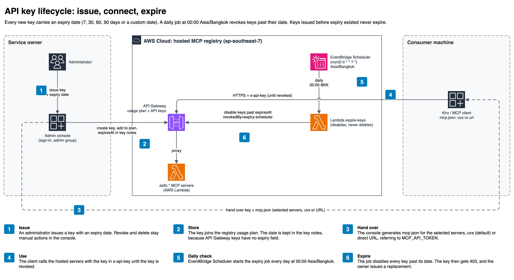

# MSC Labs Agent Registry

_ภาษาอื่น: [English](README.md)_

[](https://opensource.org/licenses/Apache-2.0)
[](https://www.python.org/downloads/)
[](https://pypi.org/project/aidlc.devsecops-cicd-mcp/)

Repository นี้เป็นแหล่งรวมการกำหนดค่ากลางขององค์กรสำหรับการพัฒนาซอฟต์แวร์ด้วย AI
ทีม AI-DLC Center of Excellence (CoE) ดูแลข้อกำหนดควบคุม (guardrails) ข้อกำหนดด้านความปลอดภัย
มาตรฐานสถาปัตยกรรม และ workflow ที่ให้บริการจากส่วนกลาง ทีมพัฒนานำข้อกำหนดเหล่านี้ไปใช้ร่วมกัน
และเสนอการเปลี่ยนแปลงผ่านกระบวนการทบทวนขององค์กร

> [!IMPORTANT]
> Generative AI อาจให้ผลลัพธ์ที่ไม่ถูกต้อง โปรดตรวจผลลัพธ์ การเปลี่ยนแปลง infrastructure และ
> ค่าใช้จ่ายก่อนดำเนินการ Steering มีผลต่อพฤติกรรมของ assistant แต่ไม่รับประกันผลลัพธ์
> สิทธิ์ของ repository การอนุมัติ และ pipeline เป็นกลไกอิสระที่ตัดสินว่าการเปลี่ยนแปลงจะ merge
> หรือ deploy ได้หรือไม่

## ผู้ใช้และความรับผิดชอบ

| บทบาท | สิทธิ์ | ความรับผิดชอบ |
| --- | --- | --- |
| **AI-DLC CoE** — ผู้รับผิดชอบด้านวิศวกรรม ความปลอดภัย และสถาปัตยกรรม | เขียนผ่านการเปลี่ยนแปลงที่ผ่านการทบทวน | ดูแลมาตรฐานขององค์กรและ workflow service ที่โฮสต์ไว้ |
| **ทีมพัฒนา** | ใช้งานแบบอ่านอย่างเดียว | ใช้ข้อกำหนดที่เกี่ยวข้อง รัน workflow และเสนอการแก้ไขเมื่อมาตรฐานต้องเปลี่ยน |

การโฮสต์ฝั่ง server ป้องกันไม่ให้ทีมแก้ workflow และ policy ที่โฮสต์ไว้จากเครื่องของตน แต่ไม่ได้
บังคับนโยบายการ deploy โดยลำพัง การบังคับใช้ขึ้นอยู่กับสิทธิ์ การอนุมัติ และ DevSecOps continuous
integration and continuous delivery (CI/CD) pipeline ที่เป็นอิสระ

## เนื้อหาใน Repository

| Folder | เนื้อหา | สถานะ |
| --- | --- | --- |
| [`aidlc.kiro/steering/`](aidlc.kiro/steering/) | Guardrail, convention และข้อกำหนดด้านความปลอดภัย 129 ข้อใน compliance pack สี่ชุด | พร้อมใช้งาน |
| [`aidlc.kiro/mcp/`](aidlc.kiro/mcp/) | Workflow server ที่โฮสต์ไว้สี่ตัว bridge ที่เผยแพร่ และ runbook | พร้อมใช้งาน |
| [`aidlc.kiro/skills/`](aidlc.kiro/skills/) | Agent skill ที่ CoE แจกจ่าย | ยังไม่มีรายการ |
| [`aidlc.kiro/hooks/`](aidlc.kiro/hooks/) | Agent hook สำหรับ `.kiro/hooks/` | ยังไม่มีรายการ |

### ขอบเขต Compliance

| Pack | จำนวนข้อ | ขอบเขต |
| --- | --- | --- |
| [ASA base pack](aidlc.kiro/steering/security-requirements/asa-base-pack/) | 10 | Authentication, authorization, audit logging, การป้องกัน secret, tenant isolation และ trusted cryptography |
| [AWS Well-Architected](aidlc.kiro/steering/security-requirements/aws-well-architected/) | 32 | Encryption, network segmentation, least privilege, credential management และ threat modeling |
| [NIST CSF](aidlc.kiro/steering/security-requirements/nist-csf/) | 37 | Identify, protect, detect, respond และ recover |
| [PCI DSS](aidlc.kiro/steering/security-requirements/pci-dss/) | 50 | ขอบเขตข้อมูลผู้ถือบัตร การแบ่ง segment, logging, key management และ secure development |

ปัจจุบันยังไม่มี pack สำหรับ ISO 27001 และพระราชบัญญัติคุ้มครองข้อมูลส่วนบุคคล (PDPA)
ข้อกำหนดที่มีอยู่อาจทับซ้อนกับกรอบดังกล่าว แต่ repository นี้ไม่อ้างว่าครอบคลุมหากยังไม่มี mapping
เฉพาะ ดู [การร่วมพัฒนา](#การร่วมพัฒนา)

มาตรฐานด้านสถาปัตยกรรมและวิศวกรรมอยู่ใน
[`best-practices/`](aidlc.kiro/steering/best-practices/),
[`development-practices/`](aidlc.kiro/steering/development-practices/),
[`project-standards/`](aidlc.kiro/steering/project-standards/) และ
[`guardrails/`](aidlc.kiro/steering/guardrails/)

## การนำการกำหนดค่ากลางไปใช้

Clone repository แล้วคัดลอกเฉพาะข้อกำหนดที่เกี่ยวข้องกับระบบของคุณ:

```bash
git clone --depth 1 https://github.com/AIDLC-KIRO/msclabs.agent-registry.git /tmp/registry
mkdir -p .kiro/steering
cp -R /tmp/registry/aidlc.kiro/steering/guardrails .kiro/steering/
cp -R /tmp/registry/aidlc.kiro/steering/development-practices .kiro/steering/
cp -R /tmp/registry/aidlc.kiro/steering/security-requirements/pci-dss \
      .kiro/steering/security-requirements/
```

Commit ข้อกำหนดที่คัดลอกเพื่อบันทึก version ที่ใช้กับโครงการ ดูโหมด inclusion ใน
[steering README](aidlc.kiro/steering/README.md) ทีมอาจใช้ Git submodule แทนได้หากนโยบายการจัดการ
dependency ขององค์กรอนุญาต

ห้ามเก็บ account identifier, Amazon Resource Name (ARN), network identifier, URL ภายใน หรือ
credential ขององค์กรไว้ใน public repository นี้

## MCP Server

| Server | วัตถุประสงค์ | Tools | เอกสาร |
| --- | --- | --- | --- |
| **aidlc.devsecops-cicd** | แนะนำการเตรียมแอปพลิเคชัน การตรวจสอบนโยบาย การติดตาม pipeline และการส่งมอบงานเพื่อ deploy | 14 | [devsecops-cicd](aidlc.kiro/mcp/devsecops-cicd/README.md) |
| **aidlc.html-creator** | สร้างเอกสารสองภาษาแบบ offline จากรายงาน AWS Transform | 14 | [html-creator](aidlc.kiro/mcp/html-creator/README.md) |
| **aidlc.bpmn-creator** | สร้างแบบจำลองกระบวนการเป็น BPMN 2.0 swimlane และรองรับการทบทวนรายหน่วยงาน | 12 | [bpmn-creator](aidlc.kiro/mcp/bpmn-creator/README.md) |
| **aidlc.deck-creator** | สร้าง HTML presentation, executive summary หรือ progress report จากหลักฐานของโครงการ | 16 | [deck-creator](aidlc.kiro/mcp/deck-creator/README.md) |

PyPI package แต่ละรายการเป็น standard input/output (stdio) bridge บนเครื่องผู้ใช้ที่เชื่อมต่อไปยัง
service ที่โฮสต์ไว้ ขั้นตอน เอกสารอ้างอิง template และ policy อยู่ฝั่ง service

## สิ่งที่ต้องมี

1. Kiro IDE ซึ่งเป็น client ที่เอกสารนี้รองรับและผ่านการทดสอบ Client แบบ stdio MCP อื่นอาจต้องใช้
   การตั้งค่า command, environment variable และ variable expansion เฉพาะผลิตภัณฑ์
2. [uv](https://docs.astral.sh/uv/getting-started/installation/) สำหรับ `uvx`
3. Python 3.10 ขึ้นไป (`uv python install 3.10`)
4. Access key จากองค์กรที่ติดตั้ง service หรือจากผู้ดูแล service
5. การเชื่อมต่อ HTTPS ไปยัง `*.execute-api.ap-southeast-7.amazonaws.com`

BPMN ต้องใช้ Node.js และ [draw.io MCP server](https://www.npmjs.com/package/@drawio/mcp) เพิ่มเติม

## การขอสิทธิ์ใช้งาน

การอ่าน repository ไม่ต้องใช้ access key ส่วน hosted service ต้องใช้ข้อมูลประจำตัวที่ bridge
ส่งผ่าน request header `x-api-key` เอกสารนี้ไม่ได้อธิบายสถาปัตยกรรมการยืนยันตัวตนและการกำหนด
สิทธิ์ทั้งหมดของ service จึงไม่ควรถือว่า header ดังกล่าวเป็นกลไกกำหนดสิทธิ์โดยลำพัง

Repository นี้ยังไม่ได้ระบุช่องทางสาธารณะสำหรับขอ access key องค์กรที่ติดตั้ง service หรือ
ผู้ดูแล service ต้องแจ้งช่องทางสำหรับออกและเพิกถอน key รวมถึงช่องทางขอความช่วยเหลือภายในองค์กร
ห้ามใช้ key ร่วมกัน และต้องรายงานเหตุ key รั่วไหลผ่านช่องทางส่วนตัวที่ผู้ดูแล service กำหนด

Key ที่ออกใหม่ทุกตัวมีวันหมดอายุ ผู้ดูแล service เลือกได้ 7, 30, 60 หรือ 90 วัน หรือกำหนดวันเอง
Key ใช้ได้ถึงสิ้นวันหมดอายุตามเวลา Asia/Bangkok และจะถูกเพิกถอนโดย job ที่รันทุกวันเวลา 00:00
Asia/Bangkok หลังจากนั้น service จะตอบ `403` Key ที่ออกก่อนมีระบบวันหมดอายุไม่มีวันหมดอายุ
ควรขอ key ใหม่ก่อนถึงวันหมดอายุ

ผู้ดูแล service จะส่ง `mcp.json` มาพร้อม key โดยใส่เฉพาะ server ที่ต้องใช้ ค่าเริ่มต้นใช้ bridge
`uvx` และมีแบบเชื่อมต่อ URL โดยตรงให้เลือกด้วย (ดู [การติดตั้ง](#การติดตั้ง))



## การติดตั้ง

เก็บ key ไว้ในไฟล์ภายในเครื่องที่จำกัดสิทธิ์ คำสั่ง zsh ต่อไปนี้จะรับค่าโดยไม่แสดงบนหน้าจอ
หรือบันทึกลงในประวัติคำสั่ง:

```bash
# macOS, Linux และ WSL ที่ใช้ zsh
mkdir -p ~/.aidlc
read -rs "MCP_API_TOKEN?Access key: " && printf '\n'
printf '%s' "$MCP_API_TOKEN" > ~/.aidlc/mcp-token
unset MCP_API_TOKEN
chmod 600 ~/.aidlc/mcp-token
echo 'export MCP_API_TOKEN=$(cat ~/.aidlc/mcp-token)' >> ~/.zshrc
source ~/.zshrc
```

หากเปิด Kiro จาก Finder หรือ Dock บน macOS การตั้งค่าใน `.zshrc` เพียงอย่างเดียวไม่เพียงพอ
ให้กำหนดตัวแปรสำหรับเซสชันการเข้าสู่ระบบแบบกราฟิกในปัจจุบัน จากนั้นปิด Kiro ด้วย `Cmd+Q`
แล้วเปิดใหม่:

```bash
launchctl setenv MCP_API_TOKEN "$(cat ~/.aidlc/mcp-token)"
```

บน Windows ให้ป้อน key ผ่าน secure prompt เพื่อไม่ให้ค่าปรากฏในประวัติคำสั่ง:

```powershell
$secureKey = Read-Host "Access key" -AsSecureString
$key = [System.Net.NetworkCredential]::new("", $secureKey).Password
[Environment]::SetEnvironmentVariable("MCP_API_TOKEN", $key, "User")
Remove-Variable key, secureKey
```

การตั้งค่านี้มีผลกับ process ที่เปิดหลังจากนั้น ให้ปิดหน้าต่าง Kiro ทั้งหมด ตรวจสอบใน Task Manager
ว่าไม่มี process ของ Kiro ทำงานอยู่ แล้วจึงเปิดโปรแกรมใหม่ หากโปรแกรมยังไม่ได้รับค่าตัวแปร
อาจต้องออกจากระบบหรือเริ่ม Windows ใหม่

รวมรายการจาก [`aidlc.kiro/mcp/mcp.json`](aidlc.kiro/mcp/mcp.json) เข้ากับ MCP configuration
ระดับผู้ใช้หรือระดับโครงการของ Kiro เพิ่ม `MCP_API_TOKEN` ใน
`kiroAgent.mcpApprovedEnvVars` และคง `${MCP_API_TOKEN}` ไว้ใน `mcp.json` ห้ามบันทึกค่า key
โดยตรงในไฟล์ดังกล่าว

Client ที่รองรับ remote MCP server เชื่อมต่อ endpoint โดยตรงได้โดยไม่ผ่าน bridge แต่ละรายการใช้
`url` และส่ง key ใน header `x-api-key`:

```json
"aidlc.devsecops-cicd": {
  "url": "https://8a3gpe2ji0.execute-api.ap-southeast-7.amazonaws.com/v1/devsecops-cicd/mcp",
  "headers": { "x-api-key": "${MCP_API_TOKEN}" },
  "disabled": false
}
```

Configuration ตัวอย่างใช้ `@latest` หากทีมงานหรือระบบ continuous integration (CI) ต้องการ
ผลลัพธ์ที่ทำซ้ำได้ ให้ระบุ version ที่แน่นอน เช่น
`"aidlc.devsecops-cicd-mcp==1.0.0"` ใช้ `@latest` เฉพาะเมื่อต้องการรับ bridge version ใหม่
โดยอัตโนมัติ ทั้งสองรูปแบบใช้ workflow และ policy ชุดเดียวกันจาก hosted service
ดูรายละเอียดใน [runbook](aidlc.kiro/mcp/RUNBOOK.md)

## การใช้งาน

อธิบายผลลัพธ์ที่ต้องการในแชต ตัวอย่างเช่น:

```text
เตรียม repo my-org/my-service สำหรับ development pipeline
สร้างเว็บไซต์เอกสารจาก ./ATXDocumentation
สร้าง BPMN สำหรับกระบวนการขอลางาน
สร้าง executive summary จาก .kiro/specs/order-service
```

Server ทั้งสี่ใช้รูปแบบ tool หลักร่วมกัน แต่ session และ tool set ไม่เหมือนกันทั้งหมด ทุก server มี
start, step, status, run-log, request-draft, catalogue, reference และ asset operation ส่วน
DevSecOps, HTML และ deck มี human gate confirmation สำหรับ BPMN เป็นข้อยกเว้น โดยทบทวนกับผู้ใช้ใน
workflow step 6 และไม่มี `gate_confirm` ดูตารางใน [MCP overview](aidlc.kiro/mcp/README.md)

## สถาปัตยกรรมและขอบเขตการทำงาน


ไฟล์ต้นฉบับอยู่ที่ [`docs/diagrams/`](docs/diagrams/) ไฟล์ PNG ฝัง diagram ของ draw.io ไว้ จึงเปิดแก้ใน draw.io ได้โดยตรง

Local client หรือ assistant อาจรันคำสั่ง AWS แบบอ่านอย่างเดียวด้วย credential บนเครื่องผู้ใช้
Hosted MCP service ไม่ได้รับ AWS credential ดังกล่าว ไม่เรียก AWS แทนผู้ใช้ ไม่ push source code
และไม่ deploy การทำงานกับ source control และการ deploy ยังขึ้นอยู่กับการอนุมัติภายในเครื่อง สิทธิ์
ของ repository และ pipeline control ที่เป็นอิสระ

Tool จะได้รับเฉพาะ argument ที่ client ส่ง ตัวอย่างเช่น `cicd_changeset_validate` จะประเมิน
ข้อมูล proposed change set ที่ส่งมากับ argument โดยไม่ได้อ่านไฟล์จากเครื่องผู้ใช้ผ่านเครือข่าย
โปรดอ่าน README ของแต่ละ server ก่อนส่งข้อมูล

## การจัดการข้อมูลและความเป็นส่วนตัว

JSON-RPC tool argument จะถูกส่งจาก local bridge ไปยัง hosted service ผ่าน HTTPS ห้ามส่ง secret,
credential หรือข้อมูลที่มีกฎหมายหรือข้อกำหนดเฉพาะกำกับ เว้นแต่องค์กรอนุมัติ service สำหรับ
การใช้งานดังกล่าว Repository นี้ไม่ได้ระบุนโยบายการเก็บรักษาข้อมูล การบันทึกข้อมูลฝั่ง service
หรือถิ่นที่จัดเก็บข้อมูล โปรดสอบถามผู้ดูแล service ก่อนส่งข้อมูลที่มีข้อกำหนดด้านการจัดการเป็นพิเศษ

## Environment Variable

| ตัวแปร | คำอธิบาย | ค่าเริ่มต้น |
| --- | --- | --- |
| `MCP_API_TOKEN` | Access key; จำเป็น | — |
| `MSCLABS_MCP_TOKEN` | ชื่อตัวแปร access key สำรอง | — |
| `MSCLABS_MCP_BASE_URL` | Service deployment อื่น | CoE endpoint |
| `MSCLABS_MCP_TIMEOUT` | Request timeout เป็นวินาที | `120` |

## การแก้ปัญหา

| อาการ | แนวทาง |
| --- | --- |
| `Dynamic Client Registration rejected (HTTP 404)` | ตรวจสอบว่า Kiro ได้รับตัวแปร ชื่อตัวแปรได้รับอนุญาต และปิด–เปิดโปรแกรม Kiro ใหม่โดยสมบูรณ์แล้ว |
| `No API key` | ตัวแปร access key ที่ bridge รองรับไม่ได้ถูกส่งไปยัง bridge |
| `403 … the API key was rejected` | ตรวจสอบว่า key ครบถ้วน พิมพ์ถูกต้อง ยังไม่ถูกเพิกถอน และยังไม่หมดอายุ หากเลยวันหมดอายุแล้วให้ขอ key ใหม่ |
| `429` | รอแล้วลองใหม่โดยเพิ่มระยะเวลารอในแต่ละครั้ง สาเหตุอาจมาจาก usage plan ของ key หรือขีดจำกัดร่วมในระดับ API, stage หรือ account |
| `could not reach the registry` | ตรวจสอบ proxy, virtual private network (VPN), firewall และ Domain Name System (DNS) |
| `uvx: command not found` | ระบุ path แบบเต็มของ `uvx` หรือกำหนด `PATH` ให้ถูกต้อง |
| ไม่สร้าง BPMN diagram | ติดตั้งและกำหนดค่า draw.io MCP server แยกต่างหาก |

ไม่มี unauthenticated health route ที่ระบุในเอกสาร ให้ใช้ `tools/list` เพื่อตรวจ key และ connectivity
ตาม [runbook](aidlc.kiro/mcp/RUNBOOK.md#4-verify-connectivity-and-the-key)

## การขอความช่วยเหลือ

Repository นี้ยังไม่ได้ระบุช่องทางสนับสนุนสาธารณะหรือช่องทางส่วนตัวสำหรับรายงานเหตุด้าน
ความปลอดภัย องค์กรที่ติดตั้ง service หรือผู้ดูแล service ต้องแจ้งช่องทางดังกล่าวแก่ผู้ใช้
หากเปิดให้รายงานปัญหาผ่าน public issue ห้ามแนบ credential, tool argument ที่มีข้อมูลอ่อนไหว
หรือ log ที่ยังไม่ได้ปกปิดข้อมูล

## การร่วมพัฒนา

ทีมพัฒนาเสนอการเปลี่ยนแปลงผ่านกระบวนการทบทวนที่องค์กรกำหนด Compliance pack ใหม่ต้องอยู่ใต้
`aidlc.kiro/steering/security-requirements/<pack>/` และระบุทั้งขอบเขตที่ครอบคลุมและข้อจำกัด
ห้ามเพิ่ม secret, credential, account identifier, ARN หรือ internal endpoint ใน public repository นี้

## สัญญาอนุญาต

Apache-2.0 ดู [LICENSE](LICENSE)
