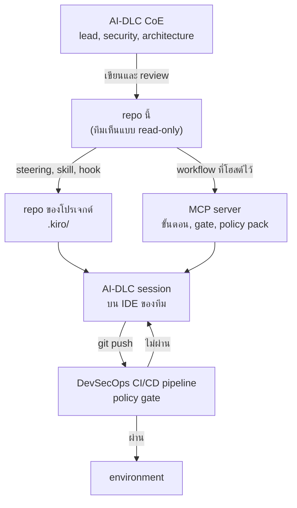
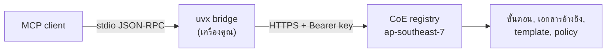

# MSC Labs Agent Registry

_อ่านภาษาอื่น: [English](README.md)_

[](https://opensource.org/licenses/Apache-2.0)
[](https://www.python.org/downloads/)
[](https://pypi.org/project/msclabs.devsecops-cicd-mcp-server/)

ที่เก็บ configuration ส่วนกลางขององค์กรสำหรับการพัฒนาด้วย AI ทีม AI-DLC Center of Excellence
ดูแล guardrails, ข้อกำหนดด้านความปลอดภัย, มาตรฐานการออกแบบสถาปัตยกรรม และ workflow ที่โฮสต์ไว้
ทั้งหมดจากที่นี่ที่เดียว ทุกทีมพัฒนาจึงได้ core framework ชุดเดียวกัน
ไม่ใช่ให้แต่ละโปรเจกต์ไปตัดสินใจเองว่าจะใช้มาตรฐานอะไร

ทีมที่ได้รับ assign โปรเจกต์มาไม่ต้องมาเถียงกันว่า "ปลอดภัยพอ" หรือ "ออกแบบดีแล้ว" หมายความว่าอะไร
ทีมดึง steering file ของส่วนกลางเข้าไปใน repo ของตัวเอง เวลารัน AI-DLC process
assistant ก็ทำงานอยู่ภายใต้กรอบนั้น และกรอบเดียวกันจะถูกบังคับอีกครั้งโดย DevSecOps CI/CD pipeline
ก่อนที่อะไรจะขึ้นไปถึง environment จริง

> [!IMPORTANT]
> Generative AI ผิดพลาดได้ ตรวจผลลัพธ์ การเปลี่ยน infrastructure และค่าใช้จ่ายทุกครั้งก่อนลงมือ
> steering กำหนดรูปร่างของสิ่งที่ assistant ผลิตออกมา แต่ไม่ได้การันตีผลลัพธ์
> ตัวที่ตัดสินว่าของจะ ship ได้หรือไม่คือ pipeline gate ไม่ใช่ตัวโมเดล

## ใครใช้ และใช้อย่างไร

| บทบาท | สิทธิ์ | ทำอะไรที่นี่ |
| --- | --- | --- |
| **AI-DLC Center of Excellence** — team lead, engineering manager, เจ้าของด้าน security และ architecture | เขียนได้ ผ่าน pull request | กำหนด guardrails, ข้อกำหนด compliance, มาตรฐานสถาปัตยกรรม และ convention ที่องค์กรใช้กับทุกโปรเจกต์ และดูแล workflow server ที่โฮสต์ไว้ |
| **ทีมพัฒนา** | **read only** | ดึง configuration ส่วนกลางเข้าไปใน repo ของโปรเจกต์ รัน AI-DLC process ภายใต้กรอบนั้น และเปิด pull request มาที่นี่เมื่อมาตรฐานต้องเปลี่ยน |

การให้สิทธิ์แค่ read only เป็นเจตนา guardrail ที่ทีมแก้เองบนเครื่องได้เพื่อให้ step ที่ fail ผ่านไป
ไม่ใช่ guardrail การเปลี่ยนมาตรฐานขององค์กรต้องผ่านการ review ของ CoE
เพื่อให้มีผลกับทุกโปรเจกต์พร้อมกัน และเหตุผลของการเปลี่ยนแต่ละครั้งถูกบันทึกไว้

## governance ไหลอย่างไร



การควบคุมมีสามชั้น แต่ละชั้นทำหน้าที่ต่างกัน

| ชั้น | รันที่ไหน | ทำอะไร | ทีมข้ามได้ไหม |
| --- | --- | --- | --- |
| **steering file** | workspace ของทีม | เอามาตรฐานขององค์กรไปวางไว้ตรงหน้า assistant ตอนที่โค้ดกำลังถูกเขียน | ได้ เพราะเป็นไฟล์บนเครื่อง จึงเป็นการชี้นำ ไม่ใช่การบังคับ |
| **workflow MCP ที่โฮสต์ไว้** | บัญชี AWS ของ CoE | ถือขั้นตอน, approval gate และ policy pack ไว้ และ `cicd_changeset_validate` ตรวจไฟล์ก่อน push | ไม่ได้ เพราะ workflow ไม่ได้อยู่บนเครื่องทีม |
| **pipeline policy gate** | DevSecOps pipeline | จุดตัดสิน บล็อกการเปลี่ยนแปลงที่ขัด policy ขององค์กร | ไม่ได้ |

steering ทำให้ draft แรกมีคุณภาพสูงขึ้น ส่วน workflow ที่โฮสต์ไว้และ pipeline เป็นตัวตัดสินว่าอะไรรับได้
ทีมได้ทั้งสองอย่าง และชั้นแรก ๆ มีอยู่เพื่อให้ชั้นสุดท้ายไม่กลายเป็นเรื่องเซอร์ไพรส์

## มีอะไรใน repo นี้

```
aidlc.kiro/
  steering/   guardrails, ข้อกำหนด compliance, convention ขององค์กร
  mcp/        workflow server ที่โฮสต์ไว้ และ client ที่ publish แล้ว
  skills/     agent skill ที่ CoE แจกจ่าย
  hooks/      agent hook สำหรับ automation และการตรวจบนเครื่อง
```

| folder | เก็บอะไร | สถานะ |
| --- | --- | --- |
| [`aidlc.kiro/steering/`](aidlc.kiro/steering/) | guardrails, convention และ security requirement 129 ข้อใน 4 pack | ใช้งานได้ |
| [`aidlc.kiro/mcp/`](aidlc.kiro/mcp/) | workflow server สามตัว, client ที่ publish แล้ว, runbook | ใช้งานได้ |
| [`aidlc.kiro/skills/`](aidlc.kiro/skills/) | agent skill ที่ CoE แจกจ่าย | ยังไม่มีรายการ |
| [`aidlc.kiro/hooks/`](aidlc.kiro/hooks/) | agent hook สำหรับ `.kiro/hooks/` | ยังไม่มีรายการ |

### ความครอบคลุมด้าน compliance และมาตรฐาน

| pack | จำนวนข้อ | ครอบคลุมอะไร |
| --- | --- | --- |
| [ASA base pack](aidlc.kiro/steering/security-requirements/asa-base-pack/) | 10 | authentication, authorization, audit logging, การป้องกัน secret, tenant isolation, cryptography ที่เชื่อถือได้ |
| [AWS Well-Architected](aidlc.kiro/steering/security-requirements/aws-well-architected/) | 32 | การเข้ารหัส, การแบ่งส่วนเครือข่าย, least privilege, การจัดการ key และ credential, threat modelling |
| [NIST CSF](aidlc.kiro/steering/security-requirements/nist-csf/) | 37 | identify, protect, detect, respond, recover |
| [PCI DSS](aidlc.kiro/steering/security-requirements/pci-dss/) | 50 | ขอบเขตข้อมูลบัตร, การแบ่งส่วน CDE, logging, การจัดการ key, การพัฒนาอย่างปลอดภัย |

**ยังไม่มี pack ของ ISO 27001 และ PDPA** ข้อกำหนดหลายข้อใน pack ที่มีอยู่แมปเข้ากับทั้งสองกรอบได้
เช่น audit logging, การจัดชั้นข้อมูล, การป้องกัน secret, data lifecycle แต่ยังไม่มี pack ไหน
ที่จัดเรียงตามกรอบเหล่านั้นหรืออ้างว่าครอบคลุมมันแล้ว การเพิ่มทำตาม [การร่วมพัฒนา](#การร่วมพัฒนา)

มาตรฐานด้านสถาปัตยกรรมและวิศวกรรมอยู่ข้าง ๆ pack ของ compliance ได้แก่
[`best-practices/`](aidlc.kiro/steering/best-practices/) (Twelve-Factor, Terraform,
บริบท Well-Architected), [`development-practices/`](aidlc.kiro/steering/development-practices/),
[`project-standards/`](aidlc.kiro/steering/project-standards/) และ
[`guardrails/`](aidlc.kiro/steering/guardrails/) ซึ่งเก็บข้อที่ต่อรองไม่ได้ไว้
คือ source code เป็นแหล่งความจริง และห้ามมโนขึ้นมาเติมช่องว่าง

## สำหรับทีมพัฒนา

### 1. ดึง configuration ส่วนกลางเข้าโปรเจกต์

clone แบบ read-only แล้วคัดลอกเฉพาะส่วนที่ตรงกับงานของคุณ เอา pack ที่โปรเจกต์ถูกประเมินด้วยจริง
ไม่ต้องเอาทั้งสี่ pack

```bash
git clone --depth 1 https://github.com/AIDLC-KIRO/msclabs.agent-registry.git /tmp/registry

mkdir -p .kiro/steering
cp -R /tmp/registry/aidlc.kiro/steering/guardrails            .kiro/steering/
cp -R /tmp/registry/aidlc.kiro/steering/development-practices .kiro/steering/
cp -R /tmp/registry/aidlc.kiro/steering/security-requirements/pci-dss \
      .kiro/steering/security-requirements/
```

commit สิ่งที่คัดลอกมาด้วย เพื่อให้มาตรฐานที่โปรเจกต์ถูกสร้างขึ้นภายใต้มันถูกบันทึกไว้คู่กัน
ถ้าจะรับของใหม่ก็รันคำสั่งคัดลอกซ้ำ ดู [steering README](aidlc.kiro/steering/README.md)
เรื่องโหมด inclusion และต้นทุนของการดึงมาทั้ง pack

ถ้าอยากติดตาม registry เป็น dependency แทนการคัดลอก ใช้ submodule ได้ (`git submodule add`)
แล้วชี้ `.kiro/steering` ไปที่ path ที่ต้องการ ทั้งสองแบบใช้ได้ เลือกแบบเดียวแล้วใช้ให้เหมือนกันทุก repo ของทีม

### 2. ต่อ workflow ที่โฮสต์ไว้

ดู [การติดตั้ง](#การติดตั้ง) ด้านล่าง workflow เป็นที่เก็บ approval gate และ policy pack
และเป็นกลไกที่ทำให้ AI-DLC process เหมือนกันทุกทีม

### 3. รัน process

พิมพ์ในแชตว่าจะทำอะไร assistant จะเรียก workflow ตามลำดับ หยุดที่ gate
และตรวจไฟล์กับ policy pack ของ CoE ก่อนคุณ push

### 4. ขอให้เปลี่ยนมาตรฐาน ดีกว่าหาทางเลี่ยง

ถ้ามาตรฐานบล็อกงานที่ควรทำได้ เปิด pull request หรือ issue มาที่นี่ นี่คือเส้นทางที่ตั้งใจไว้
และเร็วกว่าที่คิด มาตรฐานที่บล็อกทีมหนึ่งมักเป็นมาตรฐานที่ต้องแก้ให้ทุกทีม

## สำหรับ CoE

เขียนมาตรฐานเป็น steering file, review ผ่าน pull request แล้ว merge เข้า `main`
ทีมจะได้ของใหม่ตอน sync ครั้งถัดไป

เก็บค่าที่เฉพาะเจาะจงกับองค์กรไว้นอก repo นี้ เพราะ repo นี้เป็น public
account ID, ARN, VPC และ subnet ID และ URL ภายใน ควรอยู่ใน repo ส่วนตัวหรือใน SSM
steering ที่นี่ระบุข้อกำหนด ไม่ใช่ค่าของ environment

workflow ที่ต้องบังคับ policy หรือถือ gate ให้ทำเป็น hosted server ใน
[`aidlc.kiro/mcp/`](aidlc.kiro/mcp/) ไม่ใช่ `skills/` หรือ `steering/`
การโฮสต์ไว้คือสิ่งที่ทำให้มันมีผลผูกพัน ส่วนงานฝั่งปฏิบัติการ ทั้งการ deploy
การออกและ revoke key และการตรวจ deployment อยู่ใน [runbook](aidlc.kiro/mcp/RUNBOOK.md)

## MCP server

| server | ทำอะไร | tool | เอกสาร |
| --- | --- | --- | --- |
| **msclabs.devsecops-cicd** | เอาแอปขึ้น DevSecOps pipeline ตั้งแต่ buildspec, IaC, portability fix, push แล้วไล่ให้ pipeline เขียว | 14 | [devsecops-cicd](aidlc.kiro/mcp/devsecops-cicd/README.md) |
| **msclabs.html-creator** | เปลี่ยนรายงาน assessment ของ AWS Transform (CCA, BRE, MRA) เป็นเว็บเอกสารสองภาษาที่เปิดแบบ offline ได้ | 14 | [html-creator](aidlc.kiro/mcp/html-creator/README.md) |
| **msclabs.bpmn-creator** | วาด business process เป็น BPMN 2.0 swimlane ไฟล์ `.drawio` แล้วปรับด้วยการทบทวนรายแผนก | 12 | [bpmn-creator](aidlc.kiro/mcp/bpmn-creator/README.md) |

แต่ละตัวรันเป็น remote MCP server ในบัญชีของ CoE สิ่งที่คุณติดตั้งคือ bridge ตัวเล็ก ๆ จาก PyPI
ส่วนขั้นตอน เอกสารอ้างอิง template และ policy pack อยู่ฝั่ง server
ทุกทีมจึงรันเวอร์ชันเดียวกับที่ CoE publish

## สิ่งที่ต้องมี

1. MCP client — Kiro IDE เป็นตัวอ้างอิง ตัวอื่นที่พูด stdio MCP ได้ก็ใช้ได้
2. ติดตั้ง [uv](https://docs.astral.sh/uv/getting-started/installation/) เพื่อใช้ `uvx`
3. Python 3.10 ขึ้นไป (`uv python install 3.10`)
4. API key ที่ CoE ออกให้ — ดู [การขอสิทธิ์ใช้งาน](#การขอสิทธิ์ใช้งาน)
5. ออก HTTPS ไปยัง `rh7x5fl9j3.execute-api.ap-southeast-7.amazonaws.com` ได้

workflow `bpmn-creator` ต้องมี [draw.io MCP server](https://www.npmjs.com/package/@drawio/mcp)
และ Node.js เพิ่ม เพราะตัวมันเองไม่ได้วาด

## การขอสิทธิ์ใช้งาน

การอ่าน repo นี้ไม่ต้องขออะไร ส่วน workflow ที่โฮสต์ไว้ยืนยันตัวตนด้วย API key
หนึ่งใบต่อหนึ่งผู้ใช้ จะเป็นต่อคนหรือต่องานอัตโนมัติก็ได้ key เป็นเจ้าของ session ที่มันเปิด
การแชร์ key จึงเท่ากับแชร์ session

ขอ key จาก CoE จะได้ข้อความรูปแบบ `aidlcmcp_<12 ตัว>_<ส่วนสุ่มยาว ๆ>`
key แสดงครั้งเดียวตอนสร้าง และเก็บไว้แค่ค่า SHA-256 digest ดังนั้น key ที่หายไปกู้คืนไม่ได้
ต้อง revoke แล้วออกใบใหม่ ถ้า key หลุดให้แจ้งทันที การ revoke มีผลตั้งแต่ call ถัดไป
และกระทบแค่ใบนั้นใบเดียว

## การติดตั้ง

ตั้ง key ลง environment ก่อน

```bash
# macOS, Linux, WSL
mkdir -p ~/.aidlc
printf '%s' 'PASTE_YOUR_KEY' > ~/.aidlc/mcp-token
chmod 600 ~/.aidlc/mcp-token
echo 'export MCP_API_TOKEN=$(cat ~/.aidlc/mcp-token)' >> ~/.zshrc
```

```powershell
# Windows
setx MCP_API_TOKEN "PASTE_YOUR_KEY"
```

แล้วเพิ่ม server ลง MCP config ของ client ถ้าเป็น Kiro คือ `~/.kiro/settings/mcp.json`
สำหรับทุกโปรเจกต์ หรือ `.kiro/settings/mcp.json` สำหรับโปรเจกต์เดียว ไฟล์เดียวกันอยู่ที่
[`aidlc.kiro/mcp/mcp.json`](aidlc.kiro/mcp/mcp.json)

```json
{
  "mcpServers": {
    "msclabs.devsecops-cicd": {
      "command": "uvx",
      "args": ["msclabs.devsecops-cicd-mcp-server==1.1.0"],
      "env": { "MCP_API_TOKEN": "${MCP_API_TOKEN}" }
    },
    "msclabs.html-creator": {
      "command": "uvx",
      "args": ["msclabs.html-creator-mcp-server==1.1.0"],
      "env": { "MCP_API_TOKEN": "${MCP_API_TOKEN}" }
    },
    "msclabs.bpmn-creator": {
      "command": "uvx",
      "args": ["msclabs.bpmn-creator-mcp-server==1.1.0"],
      "env": { "MCP_API_TOKEN": "${MCP_API_TOKEN}" }
    }
  }
}
```

ใน Kiro ต้องอนุญาตชื่อตัวแปรด้วย เพิ่ม `MCP_API_TOKEN` ลงใน `kiroAgent.mcpApprovedEnvVars`
ใน user settings แล้วปิดเปิดแอปให้สุด ไม่ใช่แค่ปิดหน้าต่าง ถ้าข้ามขั้นใดขั้นหนึ่งจะได้ error
เรื่อง OAuth ที่ชี้ผิดทาง ดู [การแก้ปัญหา](#การแก้ปัญหา)

การปักเวอร์ชันเป็นเจตนา `@latest` ทำให้ทุกเครื่องดึง bridge ตัวใหม่เงียบ ๆ ทุกครั้งที่มีการ publish
ซึ่งเป็นสิ่งที่ registry ส่วนกลางมีไว้เพื่อป้องกัน

ขั้นตอนติดตั้ง ตรวจสอบ อัปเกรด และเปลี่ยน key แบบเต็มอยู่ใน [runbook](aidlc.kiro/mcp/RUNBOOK.md)

## การใช้งาน

คุณไม่ต้องเรียก tool ด้วยมือ พิมพ์ในแชตว่าจะทำอะไร assistant จะเรียก workflow ตามลำดับ
และหยุดตรงที่ server สั่งให้หยุด

```text
deploy repo my-org/my-service ขึ้น pipeline dev ให้ด้วย
ทำเว็บเอกสารจากรายงาน ATX ในโฟลเดอร์ ./ATXDocumentation
วาด flow งานขอใบลา เป็น BPMN
```

ทั้งสาม server ใช้รูปแบบ session เดียวกัน `<prefix>` คือ `cicd`, `html` หรือ `bpmn`

| tool | หน้าที่ |
| --- | --- |
| `<prefix>_start` | เปิด session |
| `<prefix>_step_get` | ขอคำสั่งและเอกสารอ้างอิงของ step ปัจจุบัน |
| `<prefix>_step_submit` | บันทึกผลและไปต่อ ถ้าข้อมูลที่บังคับไม่ครบจะถูกปฏิเสธ |
| `<prefix>_step_skip` | ข้าม step ที่ workflow กำหนดว่าข้ามได้ |
| `<prefix>_gate_confirm` | บันทึกคำตอบที่คนตอบที่ gate แล้วปลดล็อก step ถัดไป (`cicd`, `html`) |
| `<prefix>_session_status` | ดูว่า session อยู่ตรงไหน ใช้ตอนกลับมาทำต่อ |
| `<prefix>_run_log` | บันทึกหนึ่งรอบของการวนแก้ เรื่องเดิมสามรอบ session จะหยุด |
| `<prefix>_request_draft` | ร่างคำขอเวลาติดเรื่องที่อยู่นอกสิทธิ์ของคุณ |
| `<prefix>_catalogue_list`, `_reference_get`, `_asset_get` | ดึงเอกสารอ้างอิงและ template จาก server |

tool เฉพาะของแต่ละ server และลำดับขั้นแบบละเอียดอยู่ใน README ของ server นั้น

## workflow ที่โฮสต์ไว้ทำงานอย่างไร



bridge อ่าน JSON-RPC ทีละบรรทัดจาก stdin ส่งต่อขึ้นไปพร้อม API key แล้วเขียนคำตอบลง stdout
ข้อความวินิจฉัยออกทาง stderr ตัวมันใช้ Python standard library อย่างเดียว
ไม่มีแพ็กเกจของบุคคลที่สามเห็น key ของคุณ และ `uvx` เริ่มทำงานเท่ากับโหลด wheel เล็ก ๆ หนึ่งไฟล์

## ตัวแปร environment

| ตัวแปร | ใช้ทำอะไร | ค่าเริ่มต้น |
| --- | --- | --- |
| `MCP_API_TOKEN` | API key ของคุณ จำเป็น | — |
| `MSCLABS_MCP_TOKEN` | ชื่อสำรองของ key | — |
| `MSCLABS_MCP_BASE_URL` | ชี้ไป deployment อื่น | endpoint ของ CoE |
| `MSCLABS_MCP_TIMEOUT` | วินาทีที่รอต่อหนึ่ง call | `120` |

## แนวปฏิบัติ

- ตรวจ buildspec, IaC และการเปลี่ยน pipeline ที่สร้างขึ้นก่อน push workflow เตรียม change set ให้
  แต่ทีมคุณเป็นเจ้าของการ merge
- เอา pack ของ compliance ที่งานคุณถูกประเมินด้วยจริง ไม่ต้องเอาทั้งหมด
  ทุกอย่างที่ติดตั้งไปคือข้อความที่อยู่ในบริบททุก request
- ห้ามส่งค่า secret เข้า tool ใด ๆ ส่งแค่ชื่อ เช่น path ของ SSM parameter หรือชื่อ Secrets Manager
  entry ไม่ใช่ค่าข้างใน
- key หนึ่งใบต่อหนึ่งคนและต่อหนึ่งงานอัตโนมัติ ถ้าต้องเปลี่ยนให้ revoke แล้วออกใหม่ ไม่ใช่เอาไปแชร์ต่อ
- มอง gate เป็นจุดตัดสินใจที่มีเจ้าของชัดเจน ไม่ใช่ปุ่มให้กดผ่าน
- ถ้า session หยุดเพราะล้มเหลวซ้ำสามครั้ง ให้หาสาเหตุจริง ไม่ใช่เริ่มใหม่
- ถ้าต้องเปลี่ยนมาตรฐาน ให้เปลี่ยนที่นี่ ไม่ใช่หาทางเลี่ยงในโปรเจกต์เดียว
  การเลี่ยงเฉพาะที่ทำให้ทีมอื่นไม่เห็นปัญหานั้นเลย

## การแก้ปัญหา

| อาการ | วิธีแก้ |
| --- | --- |
| `Dynamic Client Registration rejected (HTTP 404)` | ไม่ใช่เรื่อง OAuth แต่ key ไปไม่ถึง server ตรวจว่าชื่อตัวแปรอยู่ในลิสต์ที่ client อนุญาต ตัวแปรมีค่าจริงใน terminal ที่เปิดใหม่ และปิดเปิด client สุดแล้ว |
| log ขึ้น `No API key` | bridge หาทั้ง `MCP_API_TOKEN` และ `MSCLABS_MCP_TOKEN` ไม่เจอ ตั้งค่าแล้วปิดเปิด client |
| `401`/`403 … the API key was rejected` | key ไม่ครบ พิมพ์ผิด หมดอายุ ถูก revoke หรือไม่มีสิทธิ์กับ server ตัวนั้น ให้ CoE ตรวจ |
| `could not reach the registry` | เครือข่ายออกไป endpoint ไม่ได้ ตรวจ proxy, VPN, firewall แล้วลอง curl health ด้านล่าง |
| `uvx: command not found` หรือ server ไม่ start | client หา `uvx` ใน PATH ไม่เจอ ใส่ path เต็มใน `command` หรือเพิ่ม `PATH` ใน `env` ของ server นั้น |
| call timeout | เพิ่ม `MSCLABS_MCP_TIMEOUT` ของ server นั้น เช่น `"300"` |
| ต่อติดแล้วแต่ไม่มีไดอะแกรม BPMN ออกมา | `bpmn-creator` ไม่ได้วาดเอง ต้องติดตั้ง draw.io MCP server |
| steering file เหมือนไม่มีผล | เริ่ม session ใหม่ session ที่รันอยู่ไม่รับ steering ที่เพิ่งคัดลอกมา แล้วตรวจ frontmatter `inclusion` ว่าตรงกับที่คิดไว้ |

ตรวจ health ไม่ต้องใช้ key

```bash
curl -s https://rh7x5fl9j3.execute-api.ap-southeast-7.amazonaws.com/devsecops-cicd/health
```

ตรวจ key ได้ `200` คือใช้ได้ ได้ `401` คือผิดหรือถูก revoke

```bash
curl -s -o /dev/null -w "%{http_code}\n" \
  -X POST https://rh7x5fl9j3.execute-api.ap-southeast-7.amazonaws.com/devsecops-cicd/mcp \
  -H "Authorization: Bearer $MCP_API_TOKEN" \
  -H "Content-Type: application/json" \
  -H "Accept: application/json, text/event-stream" \
  -d '{"jsonrpc":"2.0","id":1,"method":"tools/list","params":{}}'
```

ขั้นตอนวินิจฉัยแบบเต็มอยู่ใน [runbook](aidlc.kiro/mcp/RUNBOOK.md#8-troubleshooting)

## ความปลอดภัย

- repo นี้เป็น public และไม่มี secret, key, account ID หรือ endpoint ภายในอยู่เลย
  steering ระบุข้อกำหนด ไม่ใช่ค่าของ environment
- ฝั่ง server ไม่เรียก AWS แทนคุณและ deploy เองไม่ได้ การ deploy เกิดจาก `git push`
  จาก repo ของคุณเท่านั้น หลังทีมตกลงแล้ว
- key ถูกเก็บเป็นค่า SHA-256 digest การ revoke มีผลตั้งแต่ call ถัดไปโดยไม่ต้อง redeploy
  และกระทบแค่ใบที่ถูก revoke
- bridge ส่ง key ของคุณไปที่ endpoint ของ registry ที่เดียว
- ถ้าสงสัยว่า key หลุด อย่าแจ้งผ่าน public issue ให้ติดต่อ CoE โดยตรง

## ขอความช่วยเหลือ

เปิด issue พร้อมชื่อ server, เวอร์ชันของ client, บรรทัด `[msclabs.<server>]` จาก MCP log
และผลของการตรวจ health **ห้ามแนบ API key**

## การร่วมพัฒนา

ทีมพัฒนามีสิทธิ์อ่าน และร่วมพัฒนาผ่าน pull request โดย CoE เป็นผู้ review และ merge
README ของแต่ละ folder บอกโครงสร้างที่ต้องการไว้แล้ว

pack ของ compliance ตัวใหม่ เช่น ISO 27001 หรือ PDPA ให้วางที่
`aidlc.kiro/steering/security-requirements/<pack>/` พร้อม `_index.md` ที่ลิสต์ข้อกำหนดทั้งหมด
หนึ่งไฟล์ต่อหนึ่งข้อกำหนด ตามรูปแบบของ pack ที่มีอยู่ และต้องระบุให้ชัดว่า pack ครอบคลุมอะไร
และไม่ครอบคลุมอะไร pack ที่ทำให้เข้าใจว่าครอบคลุมเกินจริงแย่กว่าการไม่มี pack เลย

ห้ามมี secret, API key, account ID, ARN หรือ endpoint ภายในองค์กรอยู่ใน repo นี้

## สัญญาอนุญาต

Apache-2.0 ดู [LICENSE](LICENSE)
