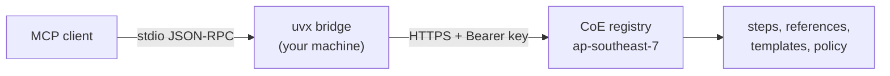

# MCP servers

Three workflow servers hosted by the MSC Labs CoE in AWS Asia Pacific (Thailand),
`ap-southeast-7`. The published PyPI packages are stdio bridges to those servers: no steps, no
policy, no cached content and no dependencies beyond the Python standard library.

| Server | Package | Version | Tools | Docs |
| --- | --- | --- | --- | --- |
| `msclabs.devsecops-cicd` | [msclabs.devsecops-cicd-mcp-server](https://pypi.org/project/msclabs.devsecops-cicd-mcp-server/) | 1.1.0 | 14 | [README](devsecops-cicd/README.md) |
| `msclabs.html-creator` | [msclabs.html-creator-mcp-server](https://pypi.org/project/msclabs.html-creator-mcp-server/) | 1.1.0 | 14 | [README](html-creator/README.md) |
| `msclabs.bpmn-creator` | [msclabs.bpmn-creator-mcp-server](https://pypi.org/project/msclabs.bpmn-creator-mcp-server/) | 1.1.0 | 12 | [README](bpmn-creator/README.md) |

## Prerequisites

1. An MCP-compatible client; Kiro IDE is the reference client
2. [uv](https://docs.astral.sh/uv/getting-started/installation/) installed, for `uvx`
3. Python 3.10+ (`uv python install 3.10`)
4. An API key from the CoE — see [Getting access](../../README.md#getting-access)
5. Outbound HTTPS to `rh7x5fl9j3.execute-api.ap-southeast-7.amazonaws.com`
6. For `bpmn-creator` only: the [draw.io MCP server](https://www.npmjs.com/package/@drawio/mcp) and Node.js

## Installation

1. Set `MCP_API_TOKEN` to your key
2. Merge [`mcp.json`](mcp.json) into `~/.kiro/settings/mcp.json` (all projects) or `.kiro/settings/mcp.json` (one project) — add the three entries to the `mcpServers` object you already have rather than nesting a second one
3. Add `MCP_API_TOKEN` to `kiroAgent.mcpApprovedEnvVars` in user settings
4. Quit and reopen the client completely. Reloading the window is not enough

Step-by-step for macOS and Windows, verification, upgrades, key rotation and diagnostics are in
the [runbook](RUNBOOK.md).

## Architecture

The bridge reads one JSON-RPC message per line from stdin, posts it upstream with your key, and
writes the reply to stdout. Diagnostics go to stderr; stdout carries the protocol and nothing
else. The hosted servers run in stateless JSON mode — one request, one response, no session to
keep alive.

Holding the workflow server-side is the point. Every team runs the version the CoE published,
and a guardrail cannot be edited on a laptop to make a failing step pass.

## Common tool pattern

You do not call tools by hand. Describe the work in chat; the assistant calls them in order.
`<prefix>` is `cicd`, `html` or `bpmn`.

| Tool | Purpose |
| --- | --- |
| `<prefix>_start` | Open a session |
| `<prefix>_step_get` | Get the current step's instructions, references and gate questions |
| `<prefix>_step_submit` | Record findings and advance; rejected if required findings are missing |
| `<prefix>_step_skip` | Skip a step the workflow marks optional |
| `<prefix>_gate_confirm` | Record a human's answer at a gate and unlock the steps behind it |
| `<prefix>_session_status` | Where the session stands, for resuming after a break |
| `<prefix>_run_log` | Log one iterate-and-verify round |
| `<prefix>_request_draft` | Draft the request to send when something is outside your control |
| `<prefix>_catalogue_list`, `_reference_get`, `_asset_get` | Pull references and templates from the server |

`bpmn-creator` has no `gate_confirm`; it reviews by walking the paths with the user in step 6.
Each server also has its own specialised tools — `cicd_changeset_validate`,
`html_scaffold_manifest`, `bpmn_validate` — listed in its README.

## Rules that apply to all three

- **The servers do not deploy and do not call AWS for you.** Deployment happens only through
  `git push` from your own repository, after your team agrees.
- **Never pass a secret value to a tool.** Pass the name — an SSM parameter path, a Secrets
  Manager entry — never the contents.
- **Gates need a human.** A gate records an answer a person actually gave. `step_submit` refuses
  to advance while required findings are missing.
- **Three strikes and the session stops.** `run_log` counts repeats; the same cause three times
  ends the session instead of letting an assistant guess indefinitely.
- **Language follows you.** All three answer in the language you ask in, and name steps and lanes
  with the words people use at work.

## License

Apache-2.0. See [LICENSE](../../LICENSE).
