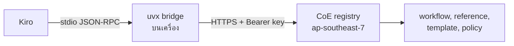

# MCP servers

MCP server ทั้งสามตัวโฮสต์โดย MSC Labs CoE บน AWS Bangkok (ap-southeast-7) แพ็กเกจบน PyPI
เป็นแค่ bridge stdio ไปยัง server ที่โฮสต์ไว้ ไม่มีขั้นตอน, policy หรือ cache อยู่ในแพ็กเกจ
และไม่มี dependency นอก Python standard library

| server | แพ็กเกจ | เวอร์ชันล่าสุด | tool | เอกสาร |
| --- | --- | --- | --- | --- |
| `msclabs.devsecops-cicd` | `msclabs.devsecops-cicd-mcp-server` | 1.1.0 | 14 | [devsecops-cicd](devsecops-cicd/README.md) |
| `msclabs.html-creator` | `msclabs.html-creator-mcp-server` | 1.1.0 | 14 | [html-creator](html-creator/README.md) |
| `msclabs.bpmn-creator` | `msclabs.bpmn-creator-mcp-server` | 1.1.0 | 12 | [bpmn-creator](bpmn-creator/README.md) |

## ติดตั้งแบบเร็ว

1. ตั้ง `MCP_API_TOKEN` เป็น key ที่ได้จาก CoE
2. วาง [`mcp.json`](mcp.json) ลงใน `~/.kiro/settings/mcp.json` (user) หรือ `.kiro/settings/mcp.json` (workspace)
3. อนุญาตตัวแปร `MCP_API_TOKEN` ใน Kiro settings
4. ปิดเปิด Kiro ให้สุด

ขั้นตอนเต็มทั้ง macOS และ Windows, การตรวจสอบ, การอัปเกรด และการแก้ปัญหา อยู่ใน [RUNBOOK.md](RUNBOOK.md)

## วิธีทำงาน

bridge อ่าน JSON-RPC ทีละบรรทัดจาก stdin ส่งต่อแบบ POST พร้อม API key แล้วเขียนคำตอบกลับ stdout
server ทำงานแบบ stateless หนึ่ง request หนึ่ง response ข้อความวินิจฉัยทั้งหมดออกทาง stderr

## รูปแบบ workflow

ทั้งสามตัวใช้ลำดับ tool เดียวกัน คุณไม่ต้องเรียก tool เอง พิมพ์ในแชตว่าจะทำอะไร Kiro จะเรียกตามลำดับ

| tool | หน้าที่ |
| --- | --- |
| `<prefix>_start` | เปิด session |
| `<prefix>_step_get` | ขอคำสั่งของ step ปัจจุบัน |
| `<prefix>_step_submit` | ส่งผลของ step ถ้าข้อมูลบังคับไม่ครบจะไม่ให้ไปต่อ |
| `<prefix>_step_skip` | ข้าม step ที่ workflow กำหนดว่าข้ามได้ |
| `<prefix>_gate_confirm` | บันทึกคำตอบของคนที่ gate แล้วปลดล็อก step ถัดไป |
| `<prefix>_session_status` | ดูว่า session อยู่ step ไหน |
| `<prefix>_run_log` | นับรอบการวนแก้ เรื่องเดิมซ้ำสามรอบ session จะหยุด |
| `<prefix>_request_draft` | ร่างคำขอถึงทีมอื่นเมื่อติดเรื่องที่อยู่นอกสิทธิ์ |
| `<prefix>_catalogue_list`, `_reference_get`, `_asset_get` | ดึงเอกสารอ้างอิงและ template จาก server |

prefix คือ `cicd`, `html`, `bpmn`

## กติกาที่ใช้กับทุกตัว

- server ไม่ deploy และไม่เรียก AWS แทนคุณ การ deploy เกิดจาก `git push` ของทีมเท่านั้น
- ห้ามส่งค่า secret เข้า tool ใด ๆ ส่งได้แค่ชื่อ เช่นชื่อ SSM parameter หรือชื่อ Secrets Manager entry
- ตอบเป็นภาษาที่คุณใช้ถาม
