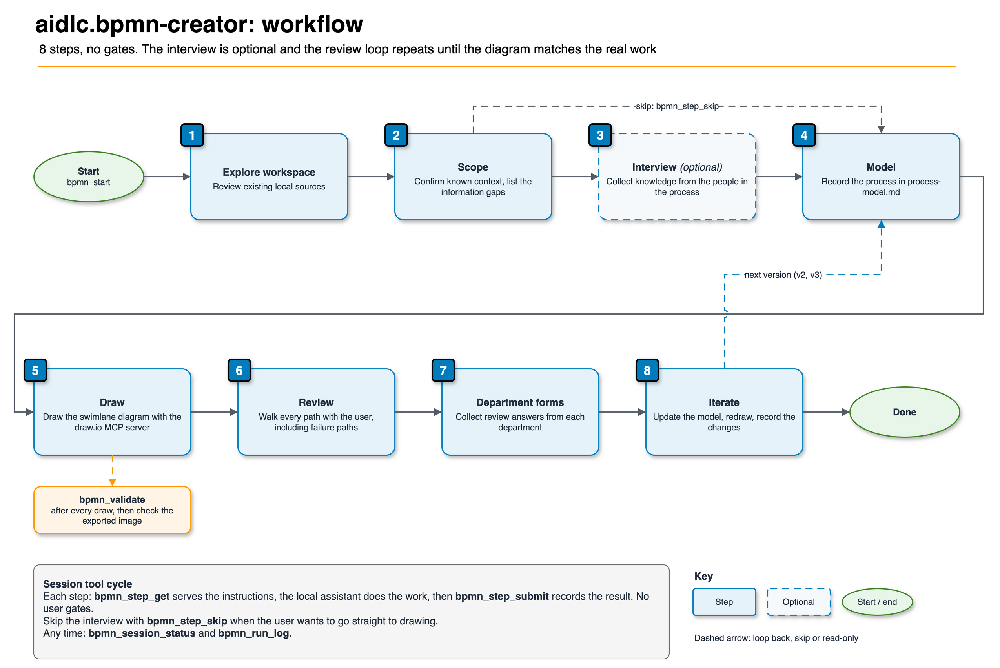

# aidlc.bpmn-creator

[](https://pypi.org/project/aidlc.bpmn-creator-mcp/)

A hosted Model Context Protocol (MCP) server for mapping a business process as a Business Process
Model and Notation (BPMN) 2.0 swimlane diagram. The result is saved as a `.drawio` file and can be
refined through departmental review.

## Features

- **Workspace-led discovery** — the local assistant reviews available specifications, documents,
  and source code before requesting information from users.
- **Structured interviews** — questions can be answered in chat or a questionnaire, or the
  optional interview can be skipped.
- **Process model as source of truth** — `process-model.md` records lanes, steps, inputs, outputs,
  systems, rules, service-level agreements (SLAs), and open questions.
- **XML validation** — `bpmn_validate` detects invalid XML, duplicate identifiers, and edges with
  missing endpoints.
- **Departmental review** — review responses can be incorporated into later diagram versions with
  a change log.

## Prerequisites

1. The [common prerequisites](../README.md#prerequisites): `uv`, Python 3.10 or later, and an access key.
2. Node.js and the [draw.io MCP server](https://www.npmjs.com/package/@drawio/mcp). The hosted
   BPMN server validates process data and diagram XML but does not draw the diagram.

## Installation

Both servers are required:

```json
{
  "mcpServers": {
    "aidlc.bpmn-creator": {
      "command": "uvx",
      "args": ["aidlc.bpmn-creator-mcp@latest"],
      "env": { "MCP_API_TOKEN": "${MCP_API_TOKEN}" }
    },
    "drawio": {
      "command": "npx",
      "args": ["-y", "@drawio/mcp@1.7.0"]
    }
  }
}
```

For an exact version, use `"args": ["aidlc.bpmn-creator-mcp==1.0.0"]`. See
[Upgrade and roll back](../RUNBOOK.md#6-upgrade-and-roll-back). Environment variables are listed
in the [registry README](../../../README.md#environment-variables).

## Available tools

### Session

| Tool | Description |
| --- | --- |
| `bpmn_start` | Start a session for the process being mapped |
| `bpmn_step_get` | Retrieve instructions and references for a step |
| `bpmn_step_submit` | Record findings and advance when required findings are complete |
| `bpmn_step_skip` | Skip an optional step with a reason |
| `bpmn_session_status` | Retrieve the current step, confirmed facts, reported files, and logged rounds |
| `bpmn_run_log` | Record an iteration and its result |

BPMN is the exception to the gate-capable pattern: it has no `gate_confirm` tool. User review takes
place in workflow step 6.

### Validation and content

| Tool | Description |
| --- | --- |
| `bpmn_validate` | Validate supplied swimlane XML |
| `bpmn_catalogue_list` | List hosted steps, references, templates, and scripts |
| `bpmn_reference_get` | Retrieve a reference document or numbered section |
| `bpmn_asset_get` | Retrieve a template whose placeholders must be completed from evidence |
| `bpmn_script_get` | Retrieve the source of a bundled script for review |
| `bpmn_request_draft` | Draft a request for an action outside the user's control |

## Workflow



| Step | Activity |
| --- | --- |
| 1 Explore workspace | Review existing local sources |
| 2 Scope | Confirm known context and identify information gaps |
| 3 Interview | Collect knowledge from process participants. **Optional** |
| 4 Model | Record the process in `process-model.md` |
| 5 Draw | Use the draw.io MCP server to create the swimlane diagram |
| 6 Review | Walk each path from start to end with the user, including failure paths |
| 7 Department forms | Collect review responses from relevant departments |
| 8 Iterate | Update the model, redraw the diagram, and record changes |

## Usage

```text
Map the leave request process as BPMN
Skip the interview and draw from the available documentation
```

Validate XML after each drawing update. XML validation does not detect visual overlap; verify the
exported image before making layout claims.

## Boundaries and data handling

Drawing is performed by the separate draw.io MCP server. The hosted BPMN service provides workflow
content and evaluates arguments submitted to its tools; it does not inspect local files directly.
Tool arguments are sent over HTTPS. Do not submit secrets or unapproved sensitive process data. See
the [common data-handling guidance](../README.md#data-handling-and-privacy).

## License

Apache-2.0. See [LICENSE](../../../LICENSE).
