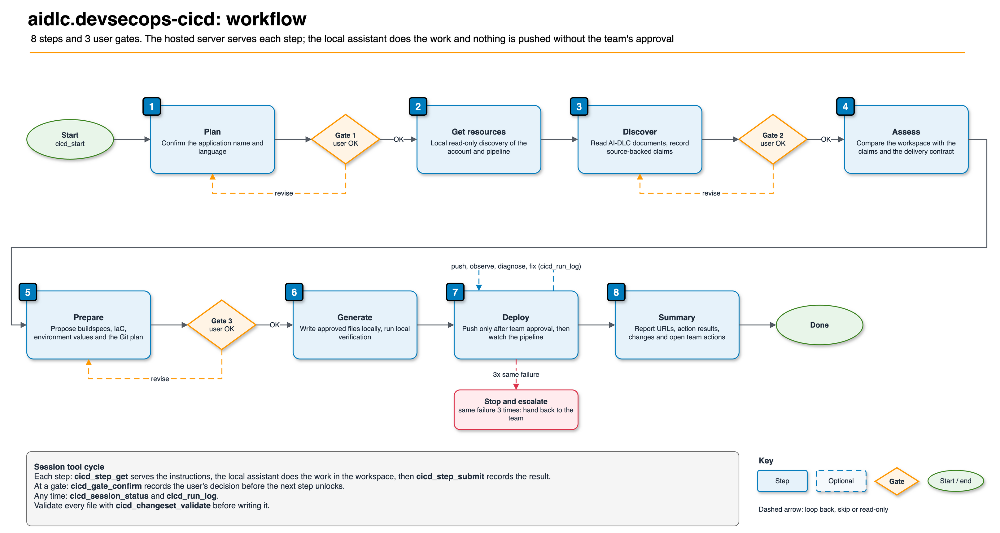

# aidlc.devsecops-cicd

[](https://pypi.org/project/aidlc.devsecops-cicd-mcp/)

A hosted Model Context Protocol (MCP) server that guides an application through an AI-DLC
DevSecOps continuous integration and continuous delivery (CI/CD) workflow. It provides workflow
steps, policy findings, templates, and status rendering while deployment remains under local and
pipeline control.

## Features

- **Read-only discovery guidance** — the local client or assistant can inspect the configured AWS
  account, pipeline, Region, and network by using credentials available on the user's machine.
- **Evidence-based assessment** — codebase claims are checked against local source evidence.
- **Policy review before push** — `cicd_changeset_validate` evaluates proposed change-set data sent
  in tool arguments and returns findings by severity and owner. The hosted service does not read
  the local filesystem directly.
- **Human decision gates** — the workflow records decisions for application identity, target
  Region, and the proposed change set.
- **Pipeline triage** — the local assistant can inspect pipeline state, diagnose failed actions,
  and use the server to render a status page.
- **Request drafting** — the server drafts requests for actions outside the user's permissions.

## Prerequisites

1. The [common prerequisites](../README.md#prerequisites): `uv`, Python 3.10 or later, and an access key.
2. Local AWS credentials with read access to the target account when discovery is required.
3. For preparation and deployment steps, push rights on the application repository and an
   authorized person to approve the push.

## Installation

```json
{
  "mcpServers": {
    "aidlc.devsecops-cicd": {
      "command": "uvx",
      "args": ["aidlc.devsecops-cicd-mcp@latest"],
      "env": { "MCP_API_TOKEN": "${MCP_API_TOKEN}" }
    }
  }
}
```

For an exact version, use `"args": ["aidlc.devsecops-cicd-mcp==1.0.0"]`. See
[Upgrade and roll back](../RUNBOOK.md#6-upgrade-and-roll-back). Environment variables are listed
in the [registry README](../../../README.md#environment-variables).

## Available tools

### Session

| Tool | Description |
| --- | --- |
| `cicd_start` | Start a session for a repository identified as `org/repo` |
| `cicd_step_get` | Retrieve instructions, references, and gate questions for a step |
| `cicd_step_submit` | Record findings and advance when required findings are complete |
| `cicd_step_skip` | Skip an optional step with a reason |
| `cicd_gate_confirm` | Record a human's gate decision |
| `cicd_session_status` | Retrieve the current step, gates, facts, reported files, and logged rounds |
| `cicd_run_log` | Record an iteration and its result |

### Policy and validation

| Tool | Description |
| --- | --- |
| `cicd_policy_get` | Retrieve applicable naming, path, infrastructure-as-code, artifact, and severity policies |
| `cicd_changeset_validate` | Evaluate proposed change-set data supplied in the tool arguments |

### Content and reporting

| Tool | Description |
| --- | --- |
| `cicd_catalogue_list` | List hosted steps, references, templates, and scripts |
| `cicd_reference_get` | Retrieve a reference document or numbered section |
| `cicd_asset_get` | Retrieve a template whose placeholders must be completed from evidence |
| `cicd_render_pipeline_status` | Render supplied pipeline-state output as a self-contained HTML status page |
| `cicd_request_draft` | Draft a request for an action outside the team's control |

## Workflow



| Step | Activity |
| --- | --- |
| 1 Plan | Confirm the application name and language. **Gate 1** |
| 2 Get resources | Use local read-only discovery to inspect the actual account and pipeline configuration |
| 3 Discover | Read AI-DLC documents and record source-backed claims. **Gate 2** |
| 4 Assess | Compare the workspace with documented claims and the delivery contract |
| 5 Prepare | Propose buildspecs, portability changes, infrastructure as code (IaC), environment values, and the Git plan. **Gate 3** |
| 6 Generate | Write approved files locally and run local verification |
| 7 Deploy | Push only after team approval; observe and diagnose pipeline actions |
| 8 Summary | Report URLs, action results, changes, and outstanding team actions |

### Delivery pipeline

The diagram shows the CoE reference blueprint for the pipeline that step 7 pushes into. The pipeline
runs in a Shared Services account. Its stages are source, build, test, deploy and post-deploy, and
the deploy action assumes a role to deploy cross-account into the workload account. Organization-wide
security, compliance and governance controls apply to both accounts. The hosted server never runs
the pipeline; the team's own pipeline controls decide whether a change is deployed. The account
layout and the controls in place depend on the deploying organization.

![DevSecOps CI/CD blueprint: GitHub source through CodeConnections into CodePipeline in a Shared Services account; CodeBuild build with Amazon ECR and KMS-encrypted artifacts; security gates for unit-test, secret-detection, sca-sbom, image-scan, AWS Security Agent code review and policy-gate; a cross-account deploy role into the workload account where CloudFormation or SAM deploys ECS Fargate or Lambda; post-deploy health checks; and organization-wide controls from Organizations SCPs, Control Tower, IAM permissions boundaries, KMS, CloudTrail, AWS Config, Security Hub and GuardDuty](../../../docs/diagrams/devsecops-cicd-pipeline.drawio.png)

## Usage

```text
Deploy repo my-org/my-service to the dev pipeline
Investigate why the development pipeline is failing
Run the CoE policy packs over the proposed buildspec changes
```

## Boundaries and data handling

The hosted service does not receive local AWS credentials, call AWS on the user's behalf, push to
Git, or deploy. The local client or assistant may run read-only AWS commands with local credentials
and may perform source-control actions only under the user's approval and repository controls.

Tool arguments are sent to the hosted service over HTTPS. Do not include secret values. Refer to a
Systems Manager Parameter Store path or Secrets Manager entry by name rather than transmitting its
contents. See the [common data-handling guidance](../README.md#data-handling-and-privacy).

## License

Apache-2.0. See [LICENSE](../../../LICENSE).
